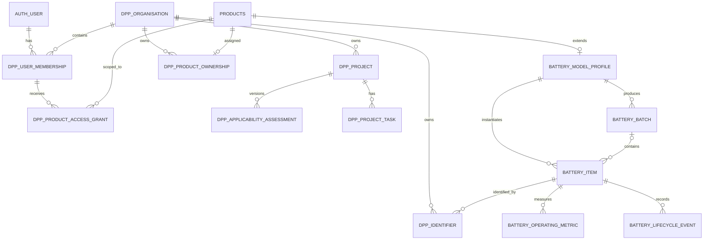
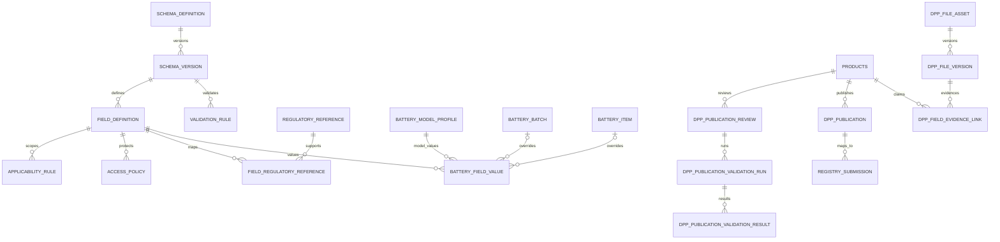

# 02 当前数据模型

## 1. 模型类型结论

当前属于 **C. 混合模式**：

- legacy 核心是固定字段：`products`、materials、BOM、ESG、certificate、traceability 等；
- 通用长尾字段使用 `dpp_field_templates` + `product_sector_field_values`；
- 新 Schema Registry 使用 `schema_definition` → `schema_version` → `field_definition` → rules/policy；
- 电池值使用真正的 `field_definition` → `battery_field_value`，并有 Model/Batch/Item scope；
- 发布使用不可变 `dpp_publication.snapshot`，但仍兼容 `product_versions` 和 live-table fallback。

它已经具备从固定字段向 Schema 驱动演进的基础，但尚未形成所有行业共用的 `schema → field → subject-scoped value` 权威路径。

## 2. 数据对象完整盘点

以下为 bootstrap + 21 个 Migration 中的真实命名；同名兼容对象只列一次。

| 类别 | 当前表/对象 |
|---|---|
| Legacy 平台/DPP | `leads`, `dpp_category_profiles`, `dpp_field_templates`, `dpp_validation_rules`, `products`, `product_sector_field_values`, `product_versions` |
| Legacy 产品关系 | `product_suppliers`, `supplier_products`, `product_materials`, `product_bom`, `product_esg_metrics`, `product_certificates`, `product_traceability`, `product_circularity`, `product_consumer_transparency`, `product_digital_identity`, `product_documents`, `product_data_governance` |
| Legacy trust/system | `dpp_registry_submissions`, `dpp_registration_proofs`, `dpp_evidence_links`, `dpp_audit_logs`, `dpp_blockchain_anchors` |
| Schema/Rule | `access_level`, `schema_definition`, `schema_version`, `regulatory_reference`, `codelist`, `codelist_value`, `field_definition`, `validation_rule`, `applicability_rule`, `field_regulatory_reference`, `access_policy` |
| 电池静态域 | `battery_schema_profile`, `battery_model_profile`, `battery_batch`, `battery_item`, `battery_field_value`, `battery_material_composition`, `battery_sustainability_data`, `battery_performance_spec`, `battery_compliance_document`, `battery_disassembly_information`, `battery_lifecycle_event` |
| 电池动态/接入 | `battery_metric_type`, `battery_operating_metric`, `battery_source_device`, `battery_integration_credential`, `battery_ingestion_request`；另有 latest view |
| 统一发布 | `dpp_identifier_alias`, `dpp_publication`, `dpp_product_publication_pointer`, `dpp_publication_review`, `dpp_publication_validation_run`, `dpp_publication_validation_result` |
| 发布迁移/切换 | `dpp_publication_read_control`, `dpp_migration_batch`, `dpp_migration_issue`, `dpp_publication_comparison`, `greanlean_0012_data_backup`, `greanlean_migration_ledger` |
| 组织/访问 | `dpp_organisation`, `dpp_user_membership`, `dpp_product_access_grant`, `dpp_access_request`, `dpp_access_audit` |
| Registry adapter | `registry_mapping`, `registry_organisation_enrolment`, `registry_submission`, `registry_validation_result`, `registry_error_log`, `registry_registration_proof` |
| 文件/证据/生命周期 | `dpp_file_asset`, `dpp_file_version`, `dpp_field_evidence_link`, `dpp_lifecycle_event` |
| 完整性连接器 | `dpp_blockchain_connector`, `dpp_blockchain_anchor_request`, `dpp_blockchain_anchor_receipt`，以及兼容 `dpp_blockchain_anchors` |
| P0 tenant/project | `dpp_economic_operator_profile`, `dpp_project`, `dpp_applicability_assessment`, `dpp_project_task`, `dpp_product_ownership`, `dpp_identifier`, `dpp_import_job`, `dpp_import_error`, `dpp_item_publication_pointer` |
| 电池法规 v2 | `battery_regulatory_catalog`, `battery_regulatory_data_point`, `battery_regulatory_applicability` |

未发现一等对象：`tenant`、`partner`、`product_family`、独立 `product_model`、独立 `sku`、通用 `field_value`、统一 `data_source`、统一 `provenance`、`credential`/`issuer`/`verification`、通用 `resolver`、通用 connector/job/secret reference。

## 3. 关键实体与真实含义

| 实体 | 当前用途 | 关键问题 |
|---|---|---|
| `dpp_organisation` | 组织/租户候选；类型可为 economic operator、service provider、authority、platform operator 等 | 没有显式 tenant/partner 层级或 binding |
| `products` | 多行业产品聚合根；实际常被当 Product Model | 无 `organisation_id`；`sku` 是字符串；状态无 DB check |
| `dpp_product_ownership` | 将 legacy product 分配给组织/项目 | 附加边界而非核心 FK；允许 legacy unassigned |
| `battery_model_profile` | 电池型号扩展，一产品一 profile | 仅电池行业；P0 后才有 nullable organisation/project |
| `battery_batch` | 电池批次 | 层级约束完善，但仅电池 |
| `battery_item` | 电池单体 | 有 serial/UPI/状态；仅电池 |
| `dpp_identifier` | P0 类型化标识 | subject 通过多个可空 FK + exactly-one check；尚未统一覆盖 DPP/组织/设施 |
| `dpp_publication` | 规范、不可变发布版本 | DPP identity 与 version 仍未拆成 passport/version 两个通用对象；以 product/item subject 扩展 |
| `schema_version` | 不可变 Schema 版本 | 已有良好基础；UI/全行业接入不足 |
| `field_definition` | 稳定 field code、类型、单位、粒度、访问、证据 | vocabulary URI 不是独立一等字段；`storage_path` 耦合存储 |
| `battery_field_value` | 电池 Model/Batch/Item scoped value | 当前唯一成熟的动态字段值表；provenance 仍是若干 text/status |
| `access_policy` | 字段 policy 配置 | 当前 access resolution 主要没有执行该表的 ABAC condition |

## 4. 当前 ER 图：legacy 通用核心

```mermaid
erDiagram
  PRODUCTS ||--o{ PRODUCT_MATERIALS : has
  PRODUCTS ||--o{ PRODUCT_BOM : has
  PRODUCTS ||--o{ PRODUCT_ESG_METRICS : has
  PRODUCTS ||--o{ PRODUCT_CERTIFICATES : has
  PRODUCTS ||--o{ PRODUCT_TRACEABILITY : has
  PRODUCTS ||--o{ PRODUCT_CIRCULARITY : has
  PRODUCTS ||--o{ PRODUCT_DOCUMENTS : has
  PRODUCTS ||--o{ PRODUCT_SECTOR_FIELD_VALUES : has
  PRODUCTS ||--o{ PRODUCT_VERSIONS : legacy_versions
  PRODUCTS ||--o{ DPP_PUBLICATION : canonical_versions
  PRODUCTS ||--o| DPP_PRODUCT_PUBLICATION_POINTER : current
  PRODUCTS ||--o{ DPP_AUDIT_LOGS : audited
  PRODUCT_SUPPLIERS ||--o{ SUPPLIER_PRODUCTS : supplies
  PRODUCTS ||--o{ SUPPLIER_PRODUCTS : sourced_by
  DPP_CATEGORY_PROFILES ||--o{ DPP_FIELD_TEMPLATES : defines
  DPP_CATEGORY_PROFILES ||--o{ PRODUCT_SECTOR_FIELD_VALUES : classifies
```



## 5. 当前 ER 图：组织、权限与 P0 层级



## 6. 当前 ER 图：Schema、值、发布与可信



注：Registry 表实际以 `product_id`、version/hash 等组合关联，并非所有关系均由单一 FK 连接到 `dpp_publication`；图表达业务关系。

## 7. 当前产品层级

真实通用关系是：

```text
dpp_organisation
  └─ dpp_product_ownership
       └─ products（实际承担 Product Model/产品聚合根；内含 sku 字符串）
            └─ battery_model_profile（仅电池）
                 ├─ battery_batch
                 └─ battery_item
                      └─ dpp_item_publication_pointer
```

- Product Family：不存在。
- Product Model：无通用独立表；`products` + 电池 `battery_model_profile` 组合承担。
- SKU：无独立实体；`products.sku`，因此当前 Model:SKU 实质为 1:0..1。
- Batch：仅电池一等表；legacy `product_digital_identity.batch_id` 是字符串。
- Individual：仅电池一等表；legacy `serial_id` 是字符串。
- DPP：通用 product-level publication；P0 增加 battery item subject。无通用 batch-level passport 实体。

## 8. 数据继承与覆盖

电池字段有实际 scope：model 值（两个 scope FK 均空）、batch 值、item 值。`loadBatteryProjection` 读取相关行并按 model → batch → item 排序，后写入 map 的更具体值覆盖上级值。因此代码具备“上级默认、下级覆盖”的雏形。

限制：

- 后台 `saveBatteryWorkspace` 当前主要写 model scope；batch/item override UI/API 不完整；
- projection 默认选第一个 item，而不是由明确 resolver subject 贯穿所有路径；
- public viewer 路径不加载 item 集合，因此公开动态投影通常只取 model 值；
- `battery_batch.variant_overrides` 存在，但不是全行业统一解析规则；
- 其他行业通常复制/平铺到 product 关联表，没有显式继承链。

## 9. DPP 与层级绑定

| 关系 | 当前状态 |
|---|---|
| `dpp_id` | 在 `products.dpp_id`，与产品聚合根绑定 |
| `model_id` | 无通用字段；电池通过 `battery_model_profile.product_id` |
| `sku_id` | 不存在；只有 `products.sku` text |
| `batch_id` | `battery_batch.id` 或 legacy identity string；publication 无通用 batch subject |
| `individual_id` | `battery_item.id`；P0 扩展 `dpp_publication.battery_item_id` |
| Model Passport | 支持：product-level `dpp_publication` |
| Batch Passport | 未形成通用、明确支持 |
| Individual Passport | 电池 P0 支持 item publication/pointer |

## 10. 标识审计

| 标识 | 当前用途 | 唯一性 | 对外 | 绑定对象 |
|---|---|---|---|---|
| UUID `id` | 数据库内部主键 | PK | 不应对外；个别 API path 使用 | 各表 |
| `products.sku` | 型号/SKU 展示与导入关联 | bootstrap 未声明 unique | 是 | product 聚合根 |
| GTIN | GS1 Digital Link | 表级未见全局 unique | 是 | `product_digital_identity` |
| `batch_id`/`serial_id` string | legacy identity | 组合查询，无统一强约束 | 是 | product identity row |
| `battery_batch.batch_identifier` | 电池批次 | model 内 unique；P0 增加 org 组合约束 | 是 | batch |
| `battery_item.serial_identifier` | 单体序列号 | model 内；P0 增加 org 内 unique | 是 | item |
| `battery_item.unique_product_identifier` | 单体 UPI URL | unique，P0 要求 HTTPS | 是 | item |
| `products.dpp_id` | 旧/当前 product DPP ID | unique | 是 | product |
| `products.public_slug` | 公开 URL slug | unique | 是 | product |
| `dpp_identifier_alias.alias` | 旧标识兼容 | active resolution | 是 | product |
| `dpp_identifier` | 类型化 MODEL/BATCH/ITEM 等标识 | normalized value global unique；exactly one target | 是 | P0 subject |
| Registry ID | EU/外部注册结果 | 各 registry 表约束 | 是 | product/submission |
| Credential ID | BMS credential metadata UUID | PK | API 内部 | source device |

主要风险：`products.sku` 同时被页面显示为“Model / SKU”，`products` 又被 P0 API 称为 product model，语义未分离；`products.dpp_id` 同时近似承担 passport identity 与公开路由 key。

## 11. 数据库结构建议摘要

| 当前对象 | 处理 | V2 建议 |
|---|---|---|
| `products` | 保留并重构 | 兼容视图/legacy root；新增明确 `product_model`，不直接破坏旧表 |
| `dpp_product_ownership` | 保留并迁移 | 将验证后的 owner 回填为所有核心对象强制 tenant FK |
| `battery_model_profile/batch/item` | 保留并泛化 | 作为电池扩展；通用 model/SKU/batch/item 另建核心 |
| `dpp_publication`/review | 保留并重构 | 引入 `dpp_passport` identity 与 `dpp_version`；旧表做兼容投影 |
| `schema_*`, `field_definition`, rules | 直接保留/增强 | 增加 vocabulary/semantic URI、tenant extension 和 promotion governance |
| `battery_field_value` | 保留并抽象 | 提取通用 subject-scoped value/provenance；电池表可兼容 |
| legacy related tables | 保留兼容 | 作为 canonical adapter source，逐步停止新增字段 |
| `dpp_organisation`/membership/grant | 保留并重构 | 明确 tenant/partner 关系、capability、scope/policy |
| `dpp_identifier`/alias | 保留并增强 | 统一 identifier + resolver + carrier；迁移代码 alias |
| registry adapter | 保留 | connector interface；不写死 EU 最终协议 |
| audit/access audit | 合并增强 | 统一不可变 audit envelope，保留专用详情表 |

完整迁移顺序见 `11-v1-v2-migration-plan.md`。
