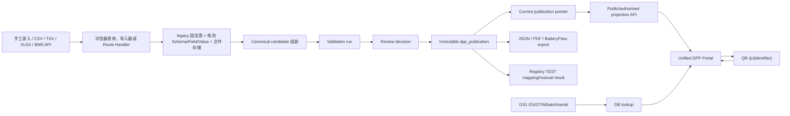
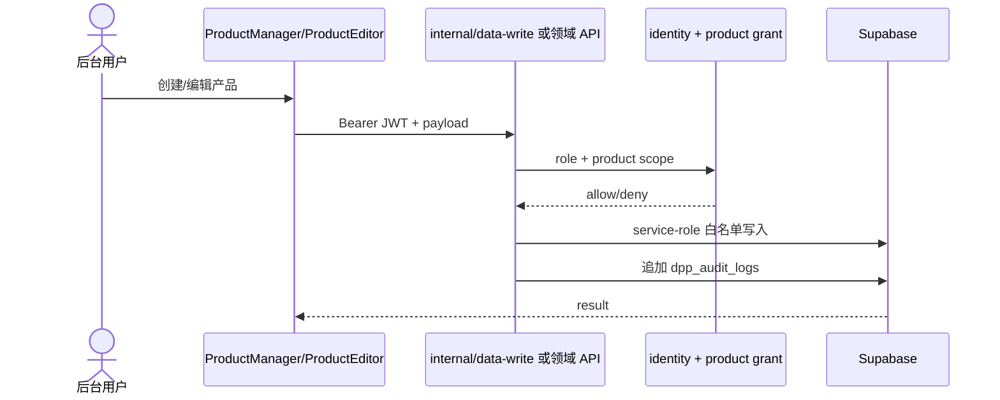
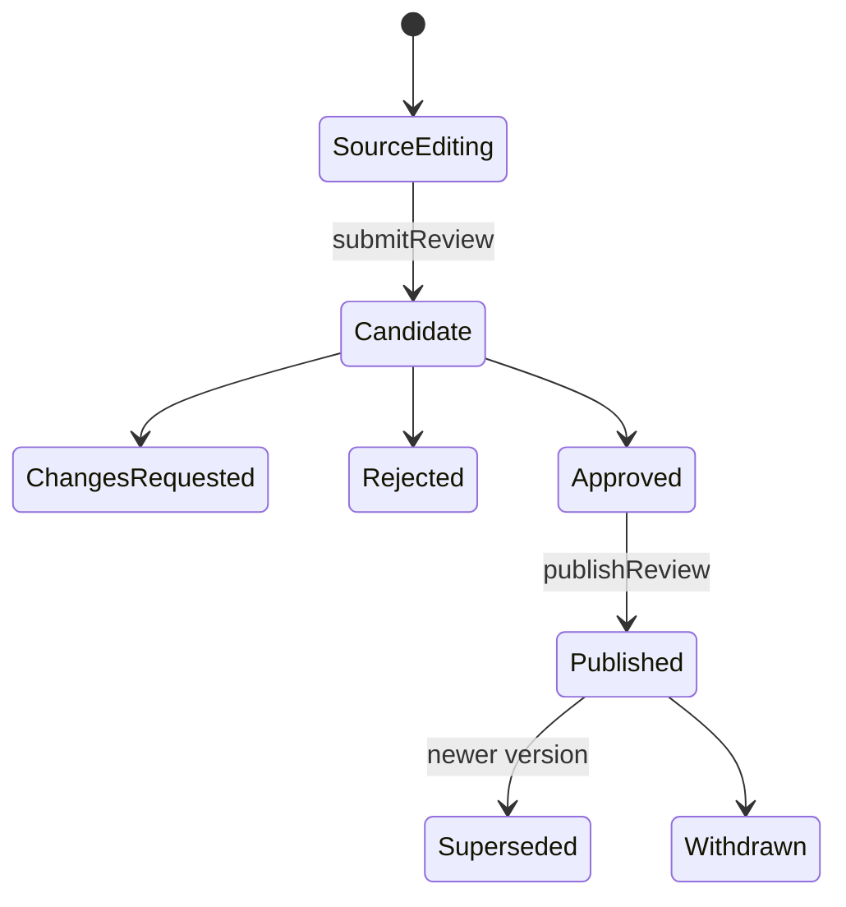

# 03 当前 DPP 全流程

## 1. 当前真实主流程

Registry 当前是 TEST 映射、校验、人工结果与重试记录，不是自动生产提交。BMS 数据通过 device credential 摄取，进入时序式 append-only 表；静态发布快照不复制全部实时点。

## 2. 创建与编辑

读取仍有两种方式：新领域工作区经服务端 API；多个 legacy manager 由浏览器直接 select Supabase 并依赖 RLS。

## 3. 导入

- 通用导入器在浏览器解析 CSV/TSV/XLSX，自带固定 sheet/column 映射和校验，再调用白名单写 API。
- `/api/v1/imports/preflight` 保存 P0 job、hash 和行字段错误，支持 `BATTERY_ITEMS`、`BOM`、`FIELD_VALUES` 预检。
- 当前 P0 commit 只支持 BOM；因此“预检能力”大于“服务端统一提交能力”。
- 未发现 JSON 文件导入 UI、外部 ERP/MES/PLM connector 或统一 mapping profile。

## 4. 发布与读取

发布流程有候选 hash、source fingerprint、validation run/result、审批人与决定、不可变 snapshot、current pointer 和审计日志。产品表自身仍使用 `draft/review/published/updated/archived/expired` 文本，Registry 使用另一套状态，电池 lifecycle 又使用独立状态；它们尚未由一个显式聚合状态机协调。

公开读取顺序：

1. item UPI 命中 `greanlean_p0_public_item_snapshot`；
2. product/alias 解析；
3. canonical current snapshot RPC；
4. legacy publication snapshot RPC；
5. legacy `product_versions` snapshot；
6. 最后回退到当前 published product 的 live related tables。

第 6 步是兼容能力，也是“页面、PDF、JSON 未必同一不可变版本”的主要剩余风险。

## 5. 当前 DPP 模块与字段来源

| 模块 | 主要字段 | 数据库/API | 层级 | 动态 | 写死程度 |
|---|---|---|---|---|---|
| Identity | DPP ID、UPI、GTIN、model/SKU、batch、serial、operator、日期 | `products`, identity, battery values, canonical snapshot | model/batch/item 混合 | 部分 | 模块与映射写死；值动态 |
| Materials | material、比例、再生、来源、BOM | material/BOM、电池 composition、snapshot | model 为主 | 否 | 表单字段写死 |
| Environment | carbon/water/energy/waste/method | ESG、电池 sustainability、sector values | model/model-year-site | 否 | legacy 映射写死；电池较动态 |
| Performance | capacity/energy/durability 等 | ESG、battery performance/field value | model/item | BMS 值另行动态 | 混合 |
| Sector | 行业法规字段 | sector value 或 battery catalogue API | 多层级 | 配置决定 | 非电池有 fallback；电池动态 |
| Traceability | production/transport/facility | `product_traceability` | model | 事件式 | 展示映射固定 |
| Evidence | certificates/documents/file versions/links | legacy evidence + private file API | product/version | 版本追加 | 模块固定，内容动态 |
| Circularity | repair/recycle/take-back/disassembly | circularity/product instructions | model | 否 | 表单字段固定 |
| Lifecycle | repair/use/reuse/recycle events | legacy traceability + `dpp_lifecycle_event` + battery events | model/batch/item | 是 | 关键字映射部分写死 |
| Operating data | SoC/SoH/cycles/temperature 等 | authorised metrics API | item/time | 是 | 指标 catalogue 部分配置 |

## 6. QR、URL 与 Resolver

当前主路径是 `QR → 完整 /p/{identifier} URL → DPP`。`/api/qr` 只把传入 URL 编码成 PNG，不登记 data carrier。GS1 是 `QR/URL → /01/... → product_digital_identity lookup → /p/...`。alias 与若干代码内旧标识提供兼容。

结论：已有解析行为，但尚无统一 Resolver 服务、持久 carrier 记录、域名路由策略和重定向管理控制面。

## 7. 关键风险

- showcase 可公开展示完整案例字段，是明确 demo bypass，必须与真实租户数据强隔离。
- 公开页允许 `preview=1` 触发 draft read 路径；能否读到数据依赖 RLS，但参数本身不应成为授权事实。
- QR endpoint 可编码任意 URL；应限制为批准 host/identifier 或明确定位为通用工具。
- legacy fallback 会读取当下行数据，可能绕过 immutable publication 的版本一致性目标。
- item、batch 和 model subject 尚未贯穿所有 resolver/export 路径。

