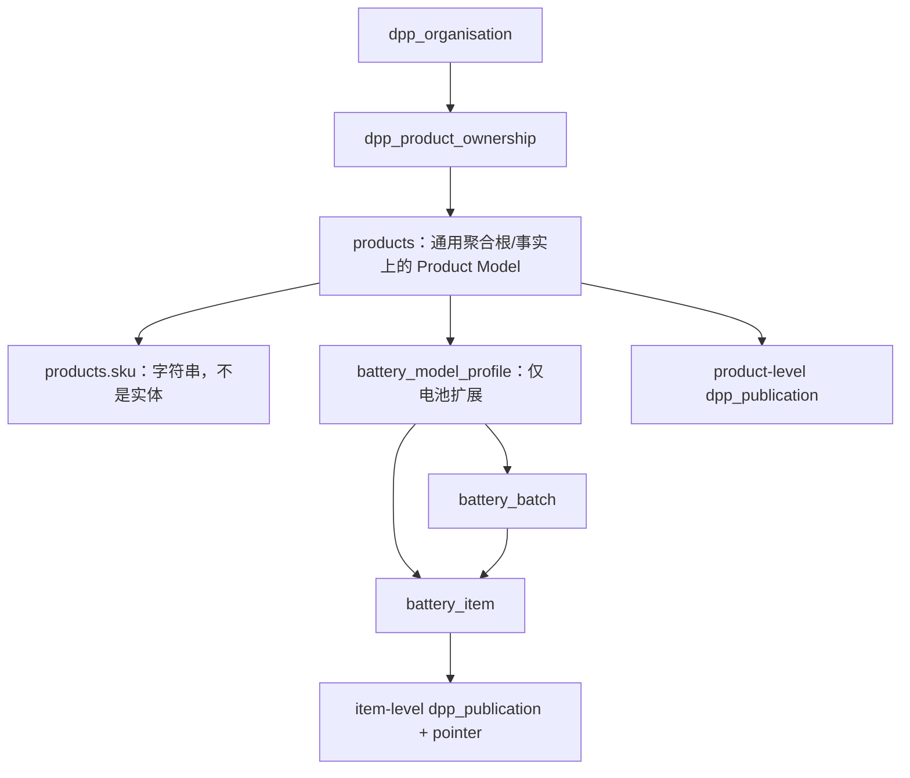
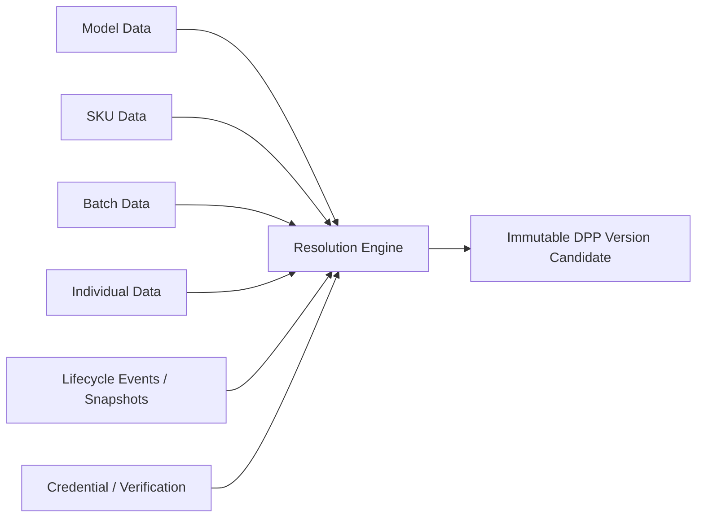

# 05 产品层级专项审计

## 1. 当前真实关系



不能画成 Product Family → Model → SKU → Batch → Individual，因为当前并不存在完整链条。

## 2. 专项问题回答

| 问题 | 结论 |
|---|---|
| Model 与 SKU 是否区分 | 否。`products` 实际被当 model，`sku` 只是属性 |
| Model:SKU | 当前最多 1:0..1，无法表达 1:N SKU |
| Batch 归属 | 电池 batch 归 `battery_model_profile`，并冗余 `product_id` 和 P0 `organisation_id` |
| Individual 归属 | 电池 item 归 model，可选归 batch，并冗余 product/org |
| Product Family | 不存在 |
| Serial Number | `battery_item.serial_identifier`；legacy `product_digital_identity.serial_id` |
| 批次号 | `battery_batch.batch_identifier`；legacy `batch_id` string |
| 单体实例 | 仅电池领域完整存在 |

P0 migration 对 model/product/org、batch/model/product/org、item/batch/model/product/org 增加组合 FK 和触发器，能拒绝电池层级错链。这是当前模型中最强的一部分。

## 3. 字段应归属的层级

| 层级 | 当前可承载 | V2 建议字段示例 |
|---|---|---|
| Tenant | organisation/operator profile | 法定主体、默认 locale、域名、配置 |
| Product Family | 无 | 品牌产品族、市场分类、系列说明 |
| Product Model | `products` + `battery_model_profile` | 型号、化学体系、额定容量、设计说明、manufacturer |
| SKU | `products.sku` text | GTIN、销售配置、包装/区域/规格变体 |
| Batch | `battery_batch` | 批号、生产日期/场所、批次碳足迹/质检 |
| Individual | `battery_item` | serial、UPI、投放日期、当前 lifecycle status |
| Lifecycle | metric/event 表 | SoH/SoC、维修、事故、再利用、回收 |

## 4. 继承/覆盖

电池 `battery_field_value` 支持 model/batch/item scope，读取时按照具体性覆盖；这比复制整套字段更合理。P0 还增加 `inheritance_schema_version` 和 `variant_overrides`，但管理界面尚未完整开放 batch/item override。

通用行业没有等价机制，通常把数据平铺到 product 关联表；当未来增加 SKU/batch/item 时容易复制同一制造商、材料或说明，形成更新漂移。

建议 V2 采用解析服务：

```text
resolved value = closest active override
  item override
  > batch override
  > SKU override
  > model value
  > family default
```

必须同时返回 `value + inheritedFrom + source + verification + effective time`，而不是只返回最终值。

## 5. DPP 数据组合

目标 Individual DPP 应动态组合：



当前只能部分实现：电池 model/batch/item value + operating/lifecycle + evidence 可以组合；SKU 层缺失，credential 不是一等对象，且公开 product 路径仍可能只取 model/live legacy 数据。

## 6. V2 最小重构方案

1. 新增通用 `product_family`、`product_model`、`sku`、`product_batch`、`product_item`，均强制 tenant FK。
2. `products` 暂不删除，增加 mapping/compatibility view；每条 legacy product 映射到一个 model，`products.sku` 初期映射为一个默认 SKU 或待确认。
3. 只有有证据时才创建 family/SKU；不根据名称猜测 1:N 关系。
4. 电池 profile 关联新 `product_model`；现有 batch/item 使用桥接 FK，双写期比较层级结果。
5. 新 `dpp_passport` 用 subject type + typed FK/check 绑定 MODEL/BATCH/ITEM；`dpp_version` 保存解析后的不可变组合结果。
6. 保留旧 DPP ID、slug、GTIN、UPI 与 QR，resolver 只改变内部目标，不改变外部链接。

## 7. 风险

- 把 `products.sku` 自动当成 Product Model ID 会继续混淆语义。
- 根据同名/品牌自动合并 family 或 model 可能错误归并客户数据。
- item publication 与 product publication 并存时版本号作用域必须明确。
- inheritance resolver 必须检测跨 tenant、跨 model 的 batch/item 错链。
- 迁移必须输出 unresolved classification 清单，不能静默复制或猜测。
