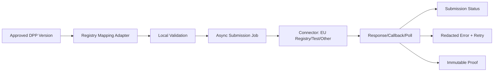

# 06 DPP 工作流与 Registry 审计

## 1. 当前状态体系

当前不是只有 draft/published，但状态分散：

| 范围 | 状态 |
|---|---|
| `products.status` | 应用使用 `draft`, `review`, `published`, `updated`, `archived`, `expired`；DB bootstrap 无 check |
| Review | `IN_REVIEW`, `CHANGES_REQUESTED`, `APPROVED`, `REJECTED`, `CANCELLED`, `PUBLISHED` |
| Publication | `PUBLISHED`, `SUPERSEDED`, `WITHDRAWN` |
| Registry submission | `PREPARING`, `VALIDATING`, `READY`, `SUBMITTED`, `REJECTED`, `FAILED`, `ACCEPTED` |
| Battery lifecycle | original/reused/repurposed/remanufactured/waste/exported/unknown，另有 P0 item 状态 |
| Project | DRAFT/ACTIVE/BLOCKED/ACCEPTANCE/COMPLETED/ARCHIVED |

优点：护照发布状态与电池生命周期状态已明确区分；review、validation、publication 都有独立表。缺点：缺少一个编排层定义合法跨状态转换，`products.status` 仍充当页面可见性和生命周期的混合信号。

## 2. 版本

正式路径 `dpp_publication` 保存连续整数版本、canonical payload、JCS/SHA-256 hash、supersedes、publisher/time，并由 pointer 指向唯一 current。Migration 触发器/函数保护不可变发布记录。

旧路径 `product_versions` 使用文本版本和 snapshot，仍被读取兼容层使用。V2 必须区分：

- Passport identity：稳定 DPP ID/subject/schema lineage；
- Passport version：不可变内容、证据、状态、hash、时间。

当前 `dpp_publication` 更接近 version，但缺少独立通用 `dpp_passport` identity。

## 3. 审核与发布

已有能力：candidate、source fingerprint、validation run/result、blocker/warning、提交人、审核人、decision reason、approved publish、current pointer、supersede、withdraw、审计。

缺口：

- Reviewer 与 Publisher 均要求 platform admin，没有职责分离；
- 没有 tenant 自有审批流程/多级审批/四眼原则配置；
- workflow definition 不是配置对象；
- `Ready for Registration/Registering/Registered/Suspended/Revoked/Archived` 未以统一状态机串联；
- 没有 outbox/job 触发异步 Registry/connector；
- product status 与 review/publication pointer 可能漂移。

## 4. Registry 兼容性

当前 adapter 已有：

- versioned `registry_mapping`；
- organisation enrolment；
- submission environment、method、payload/hash、status；
- validation result、error log、retry chain；
- registration proof append-only；
- TEST/PRODUCTION 数据字段隔离；
- feature flag 默认生产关闭；
- 本地预校验和人工 TEST 结果记录。

仓库实现明确不宣称自动 EU Registry 成功。当前 `registryRepository` 实际生成测试 mapping，并记录人工结果；未发现生产 OAuth/client、callback/webhook、自动 polling、queue/retry worker。

结论：**具备良好的 adapter 数据骨架，尚未具备可运营的生产 connector**。未来应保持 connector interface，不能把未知的 EU 最终电池语义写死进 DPP 核心。



图中 Async Job、真实 connector/callback 尚属 V2 目标，不是当前能力。

## 5. QR/Resolver 与 Registry

当前 QR 指向 GreanLean DPP URL；Registry ID 不负责页面解析。V2 应让 identifier/resolver 与 Registry connector 解耦：Registry 接口变化不应导致二维码改变。`Old URL → compatibility route/alias → resolver → passport → current version` 是正确迁移路径。

## 6. 建议状态模型

不直接改现有表，先在 V2 新对象中使用：

```text
DRAFT → DATA_PENDING / VALIDATION_FAILED → READY_FOR_REVIEW
→ APPROVED → READY_FOR_REGISTRATION
→ REGISTERING → REGISTERED → PUBLISHED
→ UPDATED / SUSPENDED / REVOKED / ARCHIVED
```

状态必须按维度拆开：content workflow、publication state、registry state、physical lifecycle state。聚合 API 可以给出统一 view，但不能把它们压成一个字符串。

## 7. 上线前 Registry 门禁

- 官方 contract/schema/version 与法律解释有 owner；
- connector contract tests、sandbox evidence、error/retry/idempotency；
- credential 从托管 secret reference 获取，不入普通字段；
- callback 验签或 polling 身份校验；
- submission 与准确 DPP version/hash 绑定；
- TEST 标识永不写入 PROD proof；
- 生产开关按 tenant 且默认 off；
- 人工补偿、暂停和回放有 runbook。

