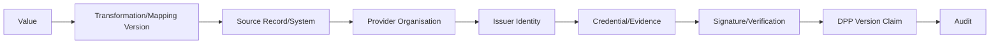

# 07 数据来源与可信审计

## 1. Provenance 现状

当前数据来源分散在：

- `product_sector_field_values.source_type/evidence_status/visibility_level`；
- `product_data_governance` 的 data source、owner、audit status、quality；
- `battery_field_value` 的 data_source、source_reference、observed_at、created_by、verification/evidence/data/expert status；
- BMS metric/event 的 source device、received/measured time、quality、credential、ingestion request；
- file version checksum + evidence link；
- publication source fingerprint + immutable hash；
- audit logs。

这证明系统已经重视来源与验证，但没有跨行业统一回答一条值的 `原始值 → 转换 → 提供者 → 录入账号 → 证据 → 凭证 → 验证 → 修订链`。

## 2. 能力矩阵

| 问题 | 当前回答能力 |
|---|---|
| 谁录入 | battery `created_by`、file/publication actor、部分 audit 可答；legacy 值不完整 |
| 来自哪个系统 | text `source_type/source_reference`；BMS device 清楚；无统一 source registry |
| 哪个企业提供 | 通常只能从 supplier/organisation/文本推断 |
| 哪个账号上传 | 新文件/发布可答；legacy document 不稳定 |
| 是否修改过 | immutable 文件/发布/event 可答；legacy tables 是 update-in-place |
| 原始值 | import job 仅错误保留 raw；通用字段缺原始/规范值双存 |
| 更新时间 | 多数表有 timestamp |
| 是否审核/验证 | 多套 status 可答，但语义不统一 |
| 关联凭证 | evidence file 可关联；VC/credential 一等模型缺失 |

## 3. Canonical Data Model

当前有 canonical publication snapshot 和稳定 field codes/json pointers 的基础，但没有独立的 canonical ingestion model。外部 CSV 列直接映射固定表；电池 BatteryPass/法规目录有适配逻辑；不同来源的名称、单位、provider 和 transformation 未通过统一 mapping/version 对象管理。

JSON-LD 准备度：

| 要素 | 当前状态 |
|---|---|
| 稳定字段 ID | 电池/Schema Registry 有；legacy 弱 |
| 数据类型 | `field_definition` 有 |
| 单位 | unit code 有，但单位 vocabulary/换算服务不完整 |
| Vocabulary URI | 未形成统一字段 |
| Schema version | 有 |
| 来源/issuer | 部分 |
| subject URI | UPI/DPP URL 有，语义未统一 |

结论：可输出项目自有 JSON，也有 BatteryPass adapter；要可靠输出 JSON-LD 仍需 semantic URI/vocabulary/context governance 和通用 subject model。

## 4. Credential/VC 兼容性

当前“credential”主要指 BMS API key；Registry proof 和证书是业务证明，但不是 W3C VC service。未发现通用：issuer、credential subject、credential status、proof/signature、revocation list、key reference、verification result。

未来可成为 Credential Subject 的对象：organisation、product model、SKU/batch/item、DPP version、field claim、lifecycle event。前提是每个 subject 都有稳定 URI/identifier 和 tenant ownership。

建议最小对象：

```text
credential
  issuer_id
  subject_type / subject_id / subject_uri
  format / schema_uri / payload_hash
  issued_at / valid_from / valid_until
  credential_status / status_reference
  proof_type / verification_method_reference
credential_verification
  credential_id / result / verifier / checked_at / reason
```

私钥只保存 KMS/Vault reference，不进 DB 普通字段。

## 5. Identity

用户身份由 Supabase Auth；企业由 `dpp_organisation`；operator profile 是版本化法定资料；BMS device 有独立 source device/credential。supplier、authority、data provider/consumer 仍主要通过 organisation type 或 legacy supplier 表表达。

系统能较好回答“谁在访问”（认证用户 + membership/grant），但对“谁提供了这条数据”只有电池/BMS/文件等新路径较完整。

## 6. Trust chain 目标



V2 应让 publication snapshot 保存 provenance reference/manifest，而不是把所有敏感原始信息复制到公开 DPP。

## 7. Vault/Key 管理

- Supabase service role 与 Registry client secret 通过 server env 约定；未发现明文入库。
- BMS plaintext key 只返回一次，数据库保存 SHA-256 hash并支持 rotation，这是良好设计。
- 未发现 Vault/KMS、secret version/owner/rotation audit、signing key、QSeal key 或 callback verification key 管理。

建议 P1 引入 secret reference abstraction；VC/QSeal 真正落地前再接 KMS/HSM。当前不要创建 DID Wallet、EUDI Wallet 或完整 QSeal。

