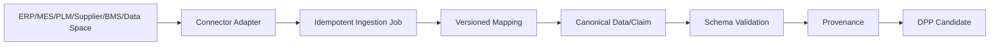

# 08 集成与数据空间审计

## 1. 当前真实接入能力

| 来源 | 当前支持 | 说明 |
|---|---|---|
| 手工录入 | 是 | 多个后台表单；legacy + battery workspace |
| CSV/TSV | 是 | 浏览器解析；固定模板 |
| XLSX | 是 | 自实现 zip/XML 解析和多 sheet 模板 |
| JSON | 导出强；导入无统一 UI | 部分 API 接收 JSON，不等于通用 JSON import |
| API | 是 | DPP、P0、BMS、Registry TEST 等 |
| ERP | 否 | 只有文案/规划提及 |
| MES | 否 | 未发现 connector |
| PLM | 否 | 未发现 connector |
| BMS/网关 | 是，限定电池 | hashed credential、binding、idempotency、range/unit/time validation |
| Supplier API | 否 | supplier 仅 legacy 数据表/手工关联 |

## 2. 字段映射与 Canonical Layer

当前固定导入模板把外部列直接映射到 `products` 和 legacy 模块表；P0 preflight 知道 BOM/items/field values；BatteryPass export 有专用 mapper；Registry 有专用 mapping。不存在可复用的：source schema → versioned mapping → transform → canonical field → target schema。

因此结论是：**当前缺少统一 Mapping Layer / Canonical Data Model ingestion service**，虽然 canonical publication 和 schema field code 已提供目标基础。

建议最小模型：`data_source`, `connector`, `connector_credential_reference`, `import_job`, `source_record`, `mapping_profile/version`, `mapping_rule`, `transformation_result`, `provenance_record`, `dead_letter/error`。

## 3. 外部接口边界

Registry 与 BMS 已各自有 repository/API，但没有统一 connector SDK、job lifecycle、retry scheduler、rate-limit policy 或 secret provider。外部接口逻辑会随新系统增加而散落。

## 4. BMS/动态数据

已有 append-only metric/event、latest projection、历史查询、质量/新鲜度、device binding、API key hash/rotation、idempotency。未发现专用时序数据库；当前使用 Postgres。也未发现 rollup/retention/partition/archival policy 或异常检测 job。

正确方向是：`Realtime → time series → aggregation → lifecycle snapshot/event → DPP`。不应把每个采样点写入静态 DPP 或签成 VC。中期应根据数据量评估 Postgres partition/Timescale/外部 TSDB，而不是现在预先迁移。

## 5. UNTP

当前具备部分基础：DPP 数据模型、JSON export、identifier、traceability、evidence、identity、schema。缺失 JSON-LD context governance、VC、conformity credentials、interoperability profile 和外部 conformance tests。

结论：**只预留 adapter 与 semantic mapping 接口，不开发完整 UNTP**。

## 6. Catena-X / EDC

当前没有 dataspace connector、policy negotiation、contract agreement、federated catalogue、external data reference 或 sovereign access receipt。现有 field access level 和 organisation/product grants可作为未来 policy input，但并非 EDC。

为支持数据不全部存入 GreanLean，V2 可增加 `external_data_reference`（provider、connector、resource、policy、cache/materialization rule、provenance）。当前只设计接口，不部署 EDC/Catena-X stack。

## 7. China Node / EU Node

当前由单一 `NEXT_PUBLIC_SUPABASE_URL` 和单 Vercel project 驱动，强绑定一个主数据库。未发现 region router、data classification、replication/outbox、regional key、residency policy、冲突处理。

建议目标是统一业务模型 + regional deployment profile：

- tenant/data object 带 residency/classification；
- identifier/resolver 全局稳定；
- publication metadata 与允许跨境的投影可同步；
- domestic/raw/dynamic/restricted 数据按 policy 留在所属节点；
- 使用 outbox + signed event + idempotency，不直接双向复制所有表。

当前不要开发多区域 active-active；先让单区域系统的 tenant、identifier、version、provenance 成为稳定边界。

## 8. 数据跨境分类

应预留：`DOMESTIC`, `CROSS_BORDER_ALLOWED`, `EU_RESIDENT`, `DYNAMIC_RESTRICTED`, `REGISTRY_PUBLIC` 等 policy classification，但分类名称必须由法律/安全评审确认。不得假设所有 DPP 原始数据都需要跨境；通常只同步已批准的 publication projection、hash、identifier 和 Registry receipt。

## 9. 运营缺口

- 无消息队列/outbox worker；
- 无 scheduled retry/credential expiry/evidence expiry job；
- 无统一 connector health/metrics；
- 无 dead-letter 与人工重放控制面；
- 无 per-tenant rate limit/quota；
- 无 schema/mapping compatibility registry；
- 无连接器级审计与 secret rotation evidence。
