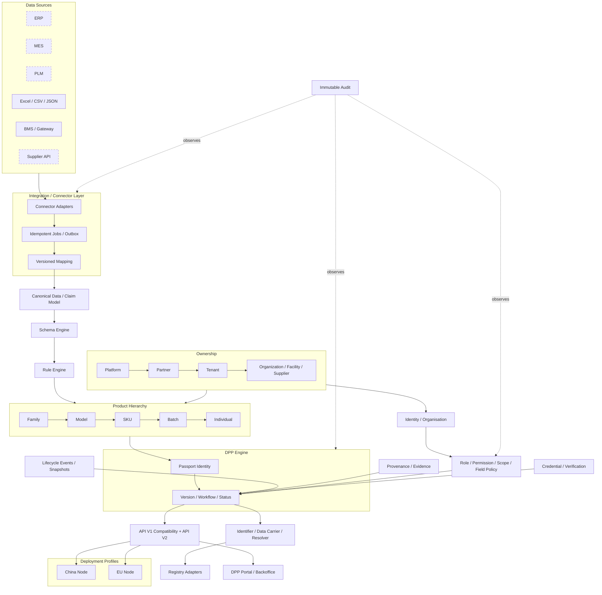
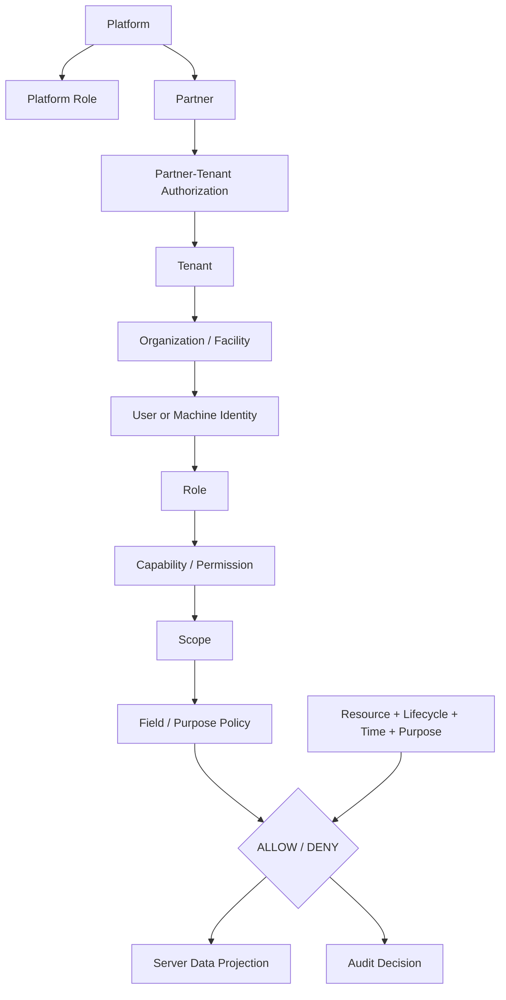
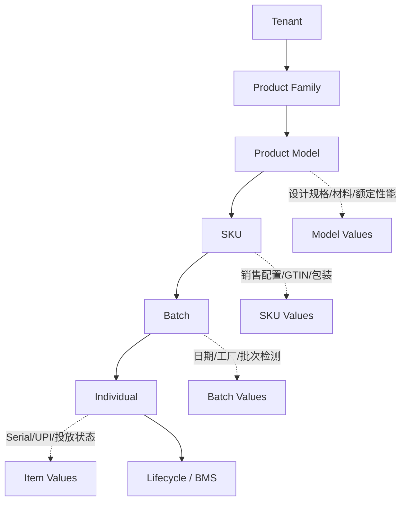

# 10 V2 目标架构

## 1. 架构原则

- Schema 驱动字段；Rule 驱动合规；Policy 驱动访问；Credential 驱动可信。
- Canonical model 隔离外部格式；DPP 前端只渲染服务器投影。
- Tenant ownership 是所有业务对象的不可绕过边界。
- DPP identity 与 immutable version 分离。
- 外部 Registry/UNTP/Catena-X/EDC 是 adapter，不进入核心领域逻辑。
- 先 additive、shadow、逐 tenant 切换；旧 URL/API/QR 保持。

## 2. 总架构图



China/EU 节点是目标部署兼容性，不是近期 active-active 实施承诺。

## 3. 权限架构图



Platform admin 不应通过客户密码进入；如确需客服代入，使用独立、短时、只读默认的 impersonation session。

## 4. 产品层级图与字段归属



Product Family 为可选，不强迫所有客户建立。SKU 不等同于 Model。

## 5. 核心服务

| 服务 | 职责 |
|---|---|
| Tenant/Organisation | tenant、partner、成员、设施、授权关系 |
| Access Policy | role/capability/scope/purpose/field 决策与审计 |
| Product Catalog | family/model/SKU/batch/item 与继承 |
| Identifier/Resolver | 内部 ID、GTIN、SKU、batch、serial、DPP ID、Registry ID、carrier、redirect |
| Schema/Rule | schema/field/unit/vocabulary/applicability/validation/regulation |
| Data Integration | connector、job、mapping、canonical、provenance |
| Lifecycle | event、snapshot、telemetry aggregation |
| Evidence/Credential | files、claims、issuer、verification；VC 为可选 adapter |
| DPP | passport identity、candidate、review、version、publication projection |
| Registry | connector contract、submission、callback/retry/proof |
| Audit | append-only operation/access/security trail |

## 6. 数据组合逻辑

Individual DPP 可以动态组合，但正式发布必须冻结解析结果：

```text
Model Data
+ SKU Data
+ Batch Data
+ Individual Data
+ Lifecycle Snapshot/Event references
+ Evidence/Credential verification
→ policy-filtered resolved candidate
→ immutable DPP Version
→ audience projection
```

每个 resolved field 同时保留 value、origin level、source/provenance、verification、effective time 和 evidence references。

## 7. API

- `/api/v1` 保持原契约，只做安全修复和兼容；
- `/api/v2/tenants`, `/organisations`, `/products/models`, `/skus`, `/batches`, `/items`, `/passports`, `/schemas`, `/imports`, `/resolvers`, `/registry-submissions` 为资源式 API；
- 命令型操作使用清晰子资源，例如 `POST /passport-reviews`、`POST /publications`，避免一个 route 的任意 action；
- 所有写入有 idempotency、tenant context、optimistic version、audit correlation；
- 外部 connector contract 独立 version。

## 8. 数据驻留

统一 schema 与代码，不建立两套业务模型。tenant/resource 上定义 residency policy；resolver 按 subject/tenant 路由；跨区同步只传批准的 publication/provenance 摘要和 identifier，不默认同步 raw/BMS/confidential 数据。

## 9. 现在不要开发

| 能力 | 决策 |
|---|---|
| 完整 UNTP | 只预留 adapter/context mapping |
| 完整 Catena-X | 只预留 connector/external reference |
| EDC | 不部署 |
| DID/EUDI Wallet | 不开发 |
| 完整 QSeal | 只预留 proof/key reference |
| 自动化生产 Registry | 等官方 contract 与业务门禁 |
| 复杂通用 ABAC | 先做有限 capability + attributes |
| 多区域 active-active | 只设计 residency 和 resolver 边界 |
| 每个 BMS 点签 VC/写 DPP | 明确不做 |
