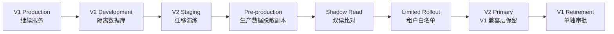

# V1 → V2 迁移计划

## 1. 目标与边界

本计划的目标不是立即迁移生产数据，而是定义一条可验证、可回滚、不中断 V1 服务的演进路径。

- V1 在 V2 建设期间继续正常提供服务。
- V2 在隔离环境中开发，先完成租户边界、产品层级和 DPP 版本语义。
- 所有结构变更先经过开发、测试、预生产与影子验证，再讨论生产切换。
- 本阶段不执行数据库迁移、数据回填、生产部署或流量切换。

## 2. 推荐迁移策略

推荐采用“扩展—回填—双读校验—有限切换—收缩”的方式：

1. **扩展**：只新增 V2 表、约束和兼容视图，不破坏 V1 表与接口。
2. **回填**：通过幂等工具生成 Tenant、Partner、Product Family、Model、SKU、Batch、Item 和 DPP Version 映射。
3. **双读校验**：V1 仍为写入主路径，V2 只读影子结果并与 V1 输出比较。
4. **有限切换**：按租户和能力开关启用 V2 写入；失败时立即回到 V1。
5. **收缩**：只有在兼容窗口结束且获得单独批准后，才停止旧写路径和旧表。

## 3. 环境与数据隔离

| 环境 | 数据库 | 外部集成 | 允许的数据 | 用途 |
|---|---|---|---|---|
| Local | 独立本地/开发实例 | Mock | 合成数据 | 开发与单元测试 |
| Development | 独立开发实例 | Sandbox/Mock | 合成数据 | Schema 与 API 联调 |
| Staging | 独立测试实例 | Sandbox | 合成与脱敏数据 | 迁移演练、集成测试 |
| Pre-production | 独立预生产实例 | 受控 Sandbox | 生产脱敏副本 | 容量、权限和回滚演练 |
| Production | 生产实例 | Production | 真实数据 | 经批准后的正式运行 |

禁止开发、测试或预生产环境直接共享生产数据库、对象存储桶、签名密钥、Registry 凭据或 BMS 凭据。

## 4. 数据模型转换矩阵

下表描述目标方向，不代表已授权实施。

| 当前表/概念 | 当前用途 | V2 处置 | V2 目标 | 迁移要点 |
|---|---|---|---|---|
| `auth.users` | 身份主体 | 保留 | Identity Provider | 不复制密码；以稳定 subject 建立映射 |
| `profiles` | 用户资料/全局角色 | 修改 | User Profile | 将租户角色移到 Membership；全局角色仅限平台管理 |
| `dpp_organisation` | 组织 | 保留并扩展 | Tenant | 补状态、法域、数据驻留与生命周期字段 |
| `dpp_organisation_membership` | 组织成员 | 保留并强化 | Tenant Membership | 唯一约束、角色范围、有效期、邀请状态 |
| `dpp_organisation_role_grant` | 组织角色授权 | 保留并重构 | RBAC Grant | 统一角色目录，避免代码与数据库双重定义漂移 |
| 缺失 | 合作伙伴实体 | 新增 | Partner | 与 Tenant 分离，保存法律主体和连接状态 |
| 缺失 | 伙伴—租户边界 | 新增 | Partner Tenant Binding | 授权范围、数据类别、有效期与审批证据 |
| `products` | 产品主记录、SKU 字符串和展示聚合 | 兼容保留，逐步拆分 | Product Model + SKU | 建立 legacy product → model/SKU 映射，不直接改写旧主键 |
| 缺失 | 产品族 | 新增 | Product Family | 可选父级；支持公共字段继承 |
| `battery_passport_profile` | 电池产品画像 | 修改/归并 | Product Model Extension | 保留电池专有属性，主身份归入通用模型 |
| `battery_batch` | 电池批次 | 保留并归一 | Batch | 关联 SKU 和 Tenant；保留旧 ID 映射 |
| `battery_item` | 电池单体 | 保留并归一 | Individual Product | 关联 Batch；序列号和运营商标识唯一性按租户定义 |
| 缺失 | 通用批次/单品 | 新增 | Batch / Individual Product | 非电池行业复用同一核心层级 |
| `product_identifiers` | 标识符 | 保留并扩展 | Identifier | 增加主体类型、发行机构、规范版本、有效期和唯一域 |
| `dpp_schema` 等 Schema Registry 表 | Schema 与版本 | 保留并强化 | Schema Registry | 明确 immutable version、状态转换和兼容规则 |
| `dpp_field_templates` | 长尾字段模板 | 迁移/兼容 | Schema Field Definition | 映射到版本化字段定义，停止新增并行语义 |
| `field_definition` | 电池字段定义 | 迁移/兼容 | Schema Field Definition | 合并重复概念，保留 source key |
| `product_sector_field_values` | 通用动态字段值 | 迁移 | Entity Field Value | 绑定实体层级、schema version 与 provenance |
| `battery_field_value` | 电池字段值 | 迁移 | Entity Field Value | 不丢失 source、单位、时间和验证状态 |
| 旧业务分表 | 材料、碳、合规、循环性等 | 兼容读取，渐进映射 | Domain Data + Provenance | 先建立字段级映射；未映射字段进入隔离报告 |
| `dpp_publication`/版本相关表 | 发布记录 | 保留并强化 | DPP + DPP Version | 发布版本不可变；草稿不得覆盖已发布版本 |
| 旧快照/实时拼装 | 公共展示后备 | 逐步淘汰 | Canonical Publication Artifact | 切换后仅允许已发布快照对外 |
| `dpp_access_audit_log` 等 | 审计事件 | 保留并统一 | Append-only Audit Log | 增加 tenant、actor、decision、policy version、correlation ID |
| 文件元数据/Storage | 私有文件和签名 URL | 保留并加强 | Document Vault | 租户前缀、恶意文件扫描、保留策略和访问审计 |
| BMS credential/metric/event | 设备数据 | 保留并隔离 | Telemetry Ingestion | 增加队列、重放保护、保留/聚合策略与设备轮换 |

## 5. 迁移映射与数据契约

每类记录必须写入不可变的迁移映射表或等效审计文件：

- `source_system`、`source_table`、`source_id`
- `target_entity_type`、`target_id`
- `tenant_id`
- `migration_run_id`、工具版本、规则版本
- `source_checksum`、`target_checksum`
- 状态：`planned`、`migrated`、`verified`、`quarantined`、`rolled_back`
- 错误码、重试次数和人工处置说明

任何无法确定租户、产品层级或字段含义的记录都必须进入隔离队列，不得通过“默认租户”或静默丢弃继续迁移。

## 6. API 演进与兼容

| 现有能力 | V2 目标 | 兼容策略 |
|---|---|---|
| 页面/API 直接读取多张旧表 | Application Service + Repository | V1 路由暂时调用适配器，不立即删除 |
| `/api/dpp/[id]` 等分散读取 | `/api/v2/dpps/{id}` | 旧路由保留，返回 deprecation header 与稳定错误码 |
| 公共页 canonical → legacy snapshot → live fallback | Resolver → immutable published version | 影子阶段记录差异；切换后禁止 live fallback |
| `/api/qr` 接收任意 URL | Identifier/Resolver Service | 仅允许批准域名和标准标识；旧二维码仍可解析 |
| 行业专用导入端点 | Import Job API | 异步任务、dry-run、错误清单、幂等键 |
| Registry TEST/manual adapter | Registry Connector | 环境隔离、凭据轮换、重试和审计 |

V2 API 需要统一：版本前缀、租户上下文、幂等键、分页、错误模型、correlation ID、授权决策和审计事件。

## 7. 旧数据兼容清单

迁移演练必须逐项验证：

- Tenant：每个旧组织都映射到唯一租户；无组织数据被明确隔离。
- Partner：从联系人、供应商或共享关系提取候选，必须人工确认后激活。
- User：身份 subject 不变；Membership 和授权有效期可追溯。
- Product：每个旧 `products.id` 保留反向映射。
- Model/SKU：无法可靠拆分时，允许建立“一模型一 SKU”过渡结构并标注推断。
- Batch/Individual：电池批次与单体保持父子关系；非电池不得伪造层级。
- DPP：发布状态、版本号、schema version、签名和时间戳均需保留。
- 图片/PDF/文件：校验对象存在、哈希、MIME、大小、租户路径和访问级别。
- QR/URL：旧 URL 永久重定向或解析到同一逻辑 DPP，不能复用给其他产品。
- API/Credential：旧令牌在过渡期受限使用，V2 凭据必须重新签发并可撤销。

## 8. 迁移工具要求

迁移工具至少支持：

1. `plan`：只分析数量、依赖、冲突和预计变更。
2. `dry-run`：执行完整转换但不提交目标数据。
3. `execute`：按租户、实体类型和游标分批提交。
4. `verify`：比较数量、关系、校验和、权限和发布输出。
5. `retry`：只重试可恢复错误，保持幂等。
6. `rollback`：按 `migration_run_id` 撤销 V2 写入，不改动 V1 原记录。
7. `report`：输出成功、失败、隔离、跳过和人工决策记录。

工具不得把控制台日志当作唯一审计证据；每次运行必须产生机器可读报告，并保留工具与规则版本。

## 9. 影子验证

在不改变用户可见结果的前提下，对相同请求执行 V1 与 V2 读取，比较：

- 租户与访问决策是否一致；
- Product/SKU/Batch/Individual 解析是否一致；
- 字段值、单位、语言和缺失值是否一致；
- 发布版本、schema version 和时间戳是否一致；
- JSON、JSON-LD、HTML、PDF 输入数据的语义校验和是否一致；
- 二维码和旧 URL 是否解析到同一逻辑资源；
- P95 延迟、错误率和外部依赖失败率。

差异必须分类为预期改进、映射缺陷、V1 历史缺陷或未知；未知差异阻止切换。

## 10. 分阶段切换与回滚

| 阶段 | 写入主路径 | 读取主路径 | 退出条件 | 回滚方式 |
|---|---|---|---|---|
| 0 基线 | V1 | V1 | 建立指标、备份与恢复证据 | 不适用 |
| 1 V2 建模 | V1 | V1 | 核心模型与权限测试通过 | 删除未启用的 V2 环境数据 |
| 2 回填演练 | V1 | V1 + V2 shadow | 数量、关系、校验和达到阈值 | 清理目标运行批次 |
| 3 有限双写 | V1 主、V2 副 | V1 | 幂等、重试、差异稳定 | 关闭租户级开关，重放失败事件 |
| 4 有限 V2 | V2（白名单） | V2（白名单） | SLO、权限、审计、业务验收通过 | 单租户回切 V1 |
| 5 V2 主路径 | V2 | V2，V1 兼容读 | 完整观察窗口无阻断问题 | 全局回切兼容层 |
| 6 V1 退役 | V2 | V2 | 另行批准、保留期结束 | 由单独退役计划定义 |

## 11. 生产切换前置条件

只有同时满足以下条件，才可提交生产切换审批：

- 已验证的生产备份与恢复演练，不只是“已开启备份”的声明；
- 所有租户隔离自动化测试和越权负向测试通过；
- Partner Tenant Binding、角色、属性策略和审计链已完成；
- 旧二维码、旧 URL 和旧 API 兼容测试通过；
- 迁移 dry-run 无未知错误，隔离数据均有业务负责人决定；
- 已发布 DPP 的版本不可变性和回滚路径通过演练；
- 外部 Registry、数据空间、BMS 与对象存储具备超时、熔断和降级方案；
- 监控、告警、运行手册、值班与事故响应已就绪；
- V1 回切能力在预生产环境完成演练；
- 安全、合规、产品和运营负责人共同签署 Go/No-Go。

## 12. 本阶段结论

V1 可以继续运行，V2 应作为隔离的并行架构建设。当前不应直接在生产库上把 `products` 拆表，也不应先删除 legacy fallback。下一步应先确认目标架构，再把本计划拆成可验收的设计与实施任务。
