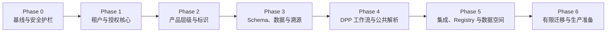

# V2 重构路线图

## 1. 路线图原则

- 先封住租户隔离、发布一致性和凭据管理等 P0 风险，再扩展功能。
- 通过兼容层演进，不做一次性重写。
- 数据模型、授权模型和版本语义先于 UI 重构。
- 每个阶段必须有可测试的退出条件和独立回滚点。
- V1 正常运行，V2 并行开发；生产迁移需另行批准。

## 2. 优先级定义

| 优先级 | 定义 | 示例 |
|---|---|---|
| P0 | 可能导致跨租户泄露、错误公开、版本覆盖、生产中断或凭据泄露 | 租户边界、公共发布单一真源、Secrets、备份恢复 |
| P1 | 阻碍核心 V2 模型和可靠运营 | Product/SKU/Batch/Item、Schema Engine、统一 Resolver、可观测性 |
| P2 | 增强互操作、自动化和规模化 | Registry 自动化、数据空间、连接器框架、国际化完善 |

## 3. 阶段总览

时间估算应在团队规模、合规范围和数据量确认后单独完成；本审计不提供未经验证的工期承诺。

## 4. Phase 0：基线与安全护栏（P0）

**目标**：在不改变用户流程的情况下，建立可安全演进的边界。

交付物：

- 冻结并记录 V1 数据模型、API、公共 URL、二维码和发布输出基线。
- 建立环境矩阵、Secrets 清单、密钥轮换与最小权限方案。
- 核验生产数据库版本、迁移账本、备份、时间点恢复和对象存储恢复。
- 为关键 API 增加统一 correlation ID、结构化日志和基础 SLO。
- 建立架构决策记录（ADR）、Schema 变更审查和迁移模板。
- 明确现有 feature flag 的所有者、默认值、作用域和退役条件。

退出条件：

- 能回答“生产当前安装了哪些迁移”和“如何在限定时间内恢复”。
- 不在日志、浏览器包或仓库中暴露服务端密钥。
- V1 关键路径已有可重复的契约测试与指标基线。

## 5. Phase 1：租户、伙伴与授权核心（P0）

**目标**：所有业务数据和访问决策都有明确租户上下文。

交付物：

- Tenant、Membership、Role Grant 的正式领域模型。
- Partner 与 Partner Tenant Binding，包含范围、有效期和审批证据。
- 统一的 Policy Decision Point，采用 RBAC + ABAC。
- 数据库行级隔离与服务层授权采用同一租户语义。
- 平台支持人员 impersonation 采用显式授权、短时会话、醒目标识和完整审计。
- 覆盖跨租户、失效成员、过期绑定、角色降级和资源枚举的负向测试。

退出条件：

- 所有 V2 请求都携带并验证 tenant context。
- 数据库测试证明任何租户不能读取或修改另一租户数据。
- Partner 未绑定、过期或范围外访问均被拒绝并记录原因。

## 6. Phase 2：产品层级与标识（P0/P1）

**目标**：建立通用且不依赖电池专用表的产品主干。

交付物：

- Product Family、Product Model、SKU、Batch、Individual Product 核心实体。
- 字段归属和继承规则：Family → Model → SKU → Batch → Individual。
- 明确覆盖、清空、继承和冲突语义，保留计算出的值来源。
- Identifier 服务支持 GTIN、序列号、批次号、内部 ID 和规范化 URI。
- Legacy `products` 到 Model/SKU 的兼容适配器和迁移映射。
- 电池 profile/batch/item 作为行业扩展接入通用层级。

退出条件：

- 可无歧义定位产品层级与标识符唯一域。
- 同一字段的最终值能够解释来自哪个层级和哪次覆盖。
- 旧产品读取结果与 V2 组合结果完成影子比对。

## 7. Phase 3：Schema、数据与溯源（P1）

**目标**：统一当前并行的动态字段机制，并让每个重要值可追溯。

交付物：

- 单一 Schema Registry：Schema、Version、Module、Field Definition、Validation Rule。
- Schema version 不可变；状态流转和兼容策略明确。
- `dpp_field_templates`、`field_definition` 和行业字段表的收敛适配方案。
- Entity Field Value 支持实体层级、单位、语言、有效期和 null 语义。
- Provenance Record 包含来源、采集时间、转换、验证、声明者和证据文件。
- Document Vault 具备租户隔离、哈希、扫描、保留和访问审计。
- 数据质量规则：必填、范围、单位、时效、冲突和异常值。

退出条件：

- UI、导入、API 和发布使用同一字段定义来源。
- 未映射或不兼容字段会失败或隔离，不会静默丢失。
- 关键字段能够回溯到原始证据和转换规则。

## 8. Phase 4：DPP 工作流与公共解析（P0/P1）

**目标**：使发布、版本、二维码和公共页面具有一致语义。

交付物：

- Draft → Review → Approved → Published → Superseded/Withdrawn 的正式状态机。
- Review Task、审批意见、职责分离和状态转换审计。
- 发布时生成不可变 DPP Version、canonical JSON/JSON-LD 和内容哈希。
- Resolver 服务统一处理内部 ID、GTIN、批次、序列号、别名和旧 URL。
- 公共页面只读取指定的已发布版本；移除实时表 fallback 前完成兼容验证。
- 二维码生成仅接受批准的标识和域名，并保留旧二维码永久解析策略。
- 稳定的 V2 API、错误模型、速率限制、缓存和撤回语义。

退出条件：

- 已发布版本不能被草稿写入改变。
- 同一标识在 HTML、JSON、JSON-LD、PDF 和二维码中解析到同一版本。
- 旧 URL、旧 QR 和旧 API 契约测试通过。

## 9. Phase 5：集成、Registry 与数据空间（P1/P2）

**目标**：把外部连接从页面/路由逻辑中剥离成可运营的连接器。

交付物：

- 异步 Import Job，支持映射、dry-run、幂等、错误报告和重试。
- ERP/MES/PLM/CSV/API 连接器 SDK 与 canonical staging model。
- BMS ingestion gateway、设备身份、重放保护、队列、保留和聚合策略。
- Registry Connector 支持环境隔离、状态同步、重试、撤销和证据保留。
- UNTP、GS1 Digital Link、Catena-X/EDC 等标准通过 adapter 接入，避免污染核心领域。
- 中国/EU 数据驻留与跨境传输策略由法务和安全确认后配置。

退出条件：

- 外部系统故障不会阻塞核心编辑或破坏已发布 DPP。
- 所有连接器具备健康指标、死信/隔离、重放和凭据轮换。
- Registry 状态与本地发布状态的偏差可监测和修复。

## 10. Phase 6：有限迁移与生产准备（P0/P1）

**目标**：以租户为单位验证 V2，并保留快速回切能力。

交付物：

- 幂等迁移工具、机器可读报告和已演练回滚。
- 生产脱敏副本上的全量迁移演练和性能测试。
- V1/V2 双读或受控双写的差异看板。
- 租户白名单、kill switch、回切运行手册和支持流程。
- 安全测试、灾难恢复演练、数据保护影响评估和业务验收。

退出条件：

- 未知数据差异为零；已知差异均有业务批准。
- 权限、性能、错误率、发布一致性和恢复目标达到批准阈值。
- Go/No-Go 与回滚责任人明确。

## 11. 工作流拆分建议

以下工作流可并行设计，但实现依赖应遵循阶段门：

| 工作流 | 关键依赖 | 首要产出 |
|---|---|---|
| Tenant & IAM | Phase 0 | Tenant context、Policy Engine、RLS 测试 |
| Product Core | Tenant & IAM | 通用层级、标识、兼容映射 |
| Schema & Provenance | Product Core | 统一 Schema、字段值与来源 |
| Publication | Schema & Provenance | 不可变版本和工作流 |
| Resolver & Public | Publication | 稳定 URL/QR/API 解析 |
| Integration | Tenant、Schema | Import/BMS/Registry adapters |
| Operations | 全部 | SLO、日志、告警、备份、恢复 |

## 12. Feature Flag 治理

当前已有若干功能开关，但审计发现部分开关未形成明确的端到端控制。V2 应统一要求：

- 开关按环境和租户配置，默认安全关闭；
- 每个开关有 owner、创建日期、作用域、指标和删除日期；
- 后端授权与数据库约束不能依赖前端开关；
- kill switch 必须经过演练；
- 迁移结束后删除临时双读/双写开关，避免永久分叉。

## 13. 明确不在本阶段实施的事项

- 不创建、修改或删除生产数据库对象。
- 不迁移生产数据或重新签发生产凭据。
- 不替换现有公共 URL、二维码或 API。
- 不启用生产 Registry、Catena-X/EDC 或跨境传输。
- 不重写整个应用，也不删除 legacy fallback。
- 不承诺生产上线日期。

## 14. 下一决策点

在进入实施前，需要确认：

1. Tenant 与 Partner 是否采用本文的分离模型；
2. 通用产品层级是否固定为 Family → Model → SKU → Batch → Individual；
3. 已发布 DPP 是否强制不可变并由 Resolver 唯一解析；
4. Schema Engine 是否成为所有行业的唯一字段定义来源；
5. V1 是否按“持续运行 + V2 并行 + 租户级渐进切换”演进。

确认目标架构后，才能把本路线图转成 ADR、技术设计、验收标准和实施任务。
