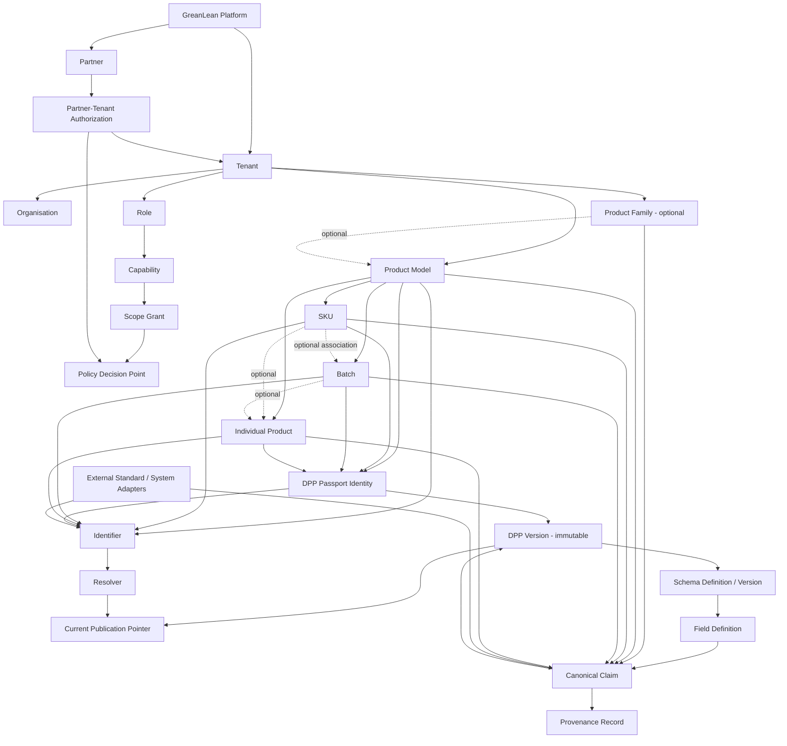

# 01 V2 Domain Boundaries

## Status

`ACCEPTED` — GreanLean V2 Architecture Baseline v2.0, accepted on 2026-09-23.

## Architecture principles

1. V2 is additive: V1 tables, routes, identifiers, and public URLs remain intact during coexistence.
2. Tenant is the mandatory SaaS isolation boundary; Organisation is a real-world actor inside or referenced by a Tenant.
3. Partner is independent from Tenant and receives access only through explicit, expiring authorization.
4. Product hierarchy supports several valid paths; Batch is not forced to belong to one SKU.
5. Passport identity is stable; every published version is immutable.
6. Schema Registry is the authority for fields, validation, applicability, and access classification.
7. Canonicalization begins at ingestion and preserves provenance.
8. One published DPP version supplies HTML, JSON, JSON-LD, PDF, API, and QR resolution.
9. Authorization uses finite roles/capabilities plus attributes; no general-purpose policy language in Phase 1.
10. Registry, UNTP, VC, Catena-X, EDC, GS1, ERP, MES, and PLM are adapters.

Partner is a platform-level entity with its own legal identity fields. It does not reference the Tenant-owned `organisation_v2` table. Tenant Membership may reference only a same-Tenant `TENANT` Role through a database-enforced composite relationship. Passport identity is unique per Tenant, subject, and `passport_profile_code`, rather than per subject alone.

## Formal V2 domain relationship



## Bounded contexts

| Context | Owns | Does not own |
|---|---|---|
| Platform & Tenant | Tenant lifecycle, platform roles, feature/residency profile | legal-entity details, product content |
| Organisation & Partner | organisations, partner identity, Partner–Tenant authorization | platform superuser rights |
| Identity & Access | memberships, role/capability, scope grants, policy decisions, impersonation audit | product values and workflow state |
| Product Catalogue | Family, Model, SKU, Batch, Individual, hierarchy constraints | DPP publication payload |
| Identifier & Resolver | identifiers, aliases, normalized values, stable resolution | Registry business workflow |
| Schema & Rules | schemas, versions, fields, validation/applicability/access policies | source-system raw data |
| Canonical Data & Provenance | source records, mappings, canonical claims, evidence lineage | public publishing pointer |
| Passport & Publication | passport identity, candidate, review, immutable version, pointer | product master ownership |
| File & Evidence | immutable file versions, evidence links, retention metadata | access policy definition |
| Integration | imports, BMS, connector jobs, receipts, retries | core domain semantics |
| Presentation | audience projection, HTML/JSON/JSON-LD/PDF | authoritative content storage |
| Operations | logs, metrics, alerts, backups, recovery | business authorization decisions |

## Dependency rules

- Product Catalogue depends on Tenant and Organisation IDs, never on UI session objects.
- Canonical Data depends on Product subjects and Schema versions.
- Passport Publication consumes resolved canonical claims; it never queries arbitrary UI tables directly.
- Resolver targets Passport identity/current published version, not a Registry response.
- Presentation is a projection of one immutable version and cannot fall back to live data after cutover.
- Adapters translate to/from contracts and cannot add fields that are absent from Schema Registry.
- Policy decisions are invoked at API/service boundaries and reinforced by database RLS.
- Service-role access never substitutes for a policy decision.

## V1 coexistence boundary

```text
V1 routes/tables
  → compatibility adapters
  → V2 services and mappings

V2 routes/tables
  → never require V1 clients to change during the compatibility window
```

V1 receives security, compatibility, and observability fixes only. New domain capabilities are built behind `/api/v2` and disabled-by-default server flags.

## Explicit exclusions

This freeze does not authorize production DDL, migration, UI rewrites, QR changes, Production Registry, complete VC/UNTP, Catena-X/EDC, EUDI Wallet, generalized ABAC, or multi-region active-active.
