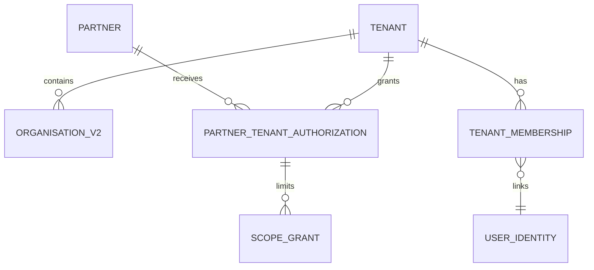

# 02 Tenant, Organisation, and Partner Model

## Accepted semantics — Architecture Baseline v2.0

### Tenant

Tenant is a GreanLean SaaS workspace and the mandatory isolation, configuration, permission, residency, and future billing boundary. It is not a legal person.

```text
tenant
- id
- code
- name
- status
- legal_jurisdiction
- default_locale
- residency_policy
- feature_profile
- created_at / updated_at
```

Every V2 business row is either directly tenant-owned or globally controlled reference data explicitly marked as such.

### Organisation

Organisation represents a real-world legal or operating actor: manufacturer, supplier, facility, importer, distributor, repairer, recycler, certification body, authority, or service provider.

```text
organisation_v2
- id
- tenant_id
- parent_organisation_id nullable
- organisation_type
- legal_name / trading_name
- country
- registration_identifier
- vat_number / eori
- address
- status
```

`dpp_organisation` remains a V1 object. It is mapped to, but not reinterpreted as, Tenant.

### Partner

Partner is a platform-recognized service organisation that may serve multiple Tenants. It is independent of Tenant ownership.

```text
partner
- id
- legal_name
- trading_name nullable
- registration_identifier nullable
- country nullable
- partner_type
- status
- created_at / updated_at
```

A Partner has no `tenant_id` and does not reference the Tenant-owned `organisation_v2` table. A Partner receives no customer access merely because it exists or because one of its users has a platform account. A future `partner_membership` or Platform Organisation Directory may be added, but Phase 1 does not force Partner ownership into a customer Tenant.

## Relationship model



Partner is not a parent of Tenant. A single Partner may receive different profiles and scopes from Tenant A and Tenant B.

## Partner–Tenant authorization

Required fields:

```text
partner_tenant_authorization
- id
- partner_id
- tenant_id
- permission_profile_id
- scope JSON or normalized scope grants
- valid_from
- valid_until nullable
- status: PENDING / ACTIVE / SUSPENDED / REVOKED / EXPIRED
- approved_by
- approval_evidence_reference
- created_at / updated_at
```

Decision rules:

- no authorization → deny;
- not yet valid, expired, suspended, or revoked → deny;
- requested capability not in permission profile → deny;
- resource outside the authorized scope → deny;
- a Tenant cannot approve access for another Tenant;
- create, approve, change, suspend, and revoke events are audited;
- when Partner user management is introduced, partner users must also have an active `partner_membership`; Phase 1 may use an explicitly verified Partner identity context without inventing a Tenant-owned Organisation.

## Tenant membership

`tenant_membership` links a user identity to exactly one Tenant per row and provides a role template. Status and validity are evaluated for every request.

Recommended states: `INVITED`, `ACTIVE`, `SUSPENDED`, `REVOKED`, `EXPIRED`.

Platform roles remain separate and exceptionally small. A platform operator does not become a Tenant member implicitly.

Database invariant:

```text
tenant_membership.(tenant_id, role_id, role_class=TENANT)
→ role.(tenant_id, id, role_class=TENANT)
```

The relationship is enforced with a composite foreign key and discriminator, not only in application code. A Membership cannot reference a different Tenant's Role or a `PLATFORM`, `PARTNER`, or `INTEGRATION` Role.

## Organisation sharing decision

Default design: an Organisation row belongs to one Tenant. If two Tenants refer to the same supplier, each initially stores its own tenant-owned representation linked by external identifiers. A future verified global-organisation directory may deduplicate identities, but must not create implicit data sharing.

This avoids a shared mutable legal entity becoming a cross-tenant side channel.

## Existing-model mapping

| V1 | V2 | Rule |
|---|---|---|
| `dpp_organisation` | `tenant` plus one primary `organisation_v2` | explicit reviewed mapping; never one-row reinterpretation |
| `dpp_user_membership` | `tenant_membership` | role translated through mapping table |
| `dpp_organisation_role_grant` | role/capability and scope grant | preserve validity and audit evidence |
| `dpp_product_ownership` | Tenant/product legacy mapping | ownership must resolve to one Tenant before migration |
| service-provider role | `partner` + authorization | no automatic conversion without business approval |

## Security invariants

1. `tenant_id` is immutable after creation for core business records; transfer is a separate audited process.
2. All composite relationships enforce matching `tenant_id` through composite FKs or guarded functions.
3. Tenant context comes from verified membership/authorization, never a client-provided header alone.
4. Database RLS checks Tenant context even when the API already authorized the request.
5. Platform/service credentials are server-only, purpose-bound, and fully audited.
6. No “default Tenant” is assigned to ambiguous legacy data.

## Acceptance criteria

- Tenant, Organisation, and Partner definitions cannot be confused in API names or database columns.
- Partner has no FK to Tenant-owned `organisation_v2`;
- Tenant Membership can reference only a same-Tenant `TENANT` Role;
- an unbound Partner is denied;
- expired and out-of-scope authorization is denied;
- the same Partner can hold different grants for two Tenants;
- all V2 product and DPP records have a non-null Tenant;
- legacy mapping can represent unknown/ambiguous status without creating fake ownership.

Related decisions: ADR-001 and ADR-002.
