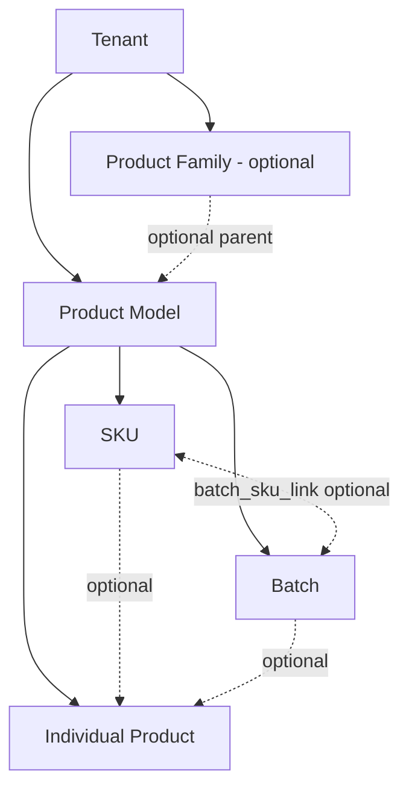

# 03 Product Hierarchy and Identifier Model

## Decision

V2 uses a flexible product graph, not a mandatory chain.



Valid examples include `Tenant → Model`, `Model → SKU`, `Model → Batch`, `Model → Item`, `Model → Batch → Item`, and `Model → SKU + Batch → Item`.

## Entity responsibilities

| Entity | Required parent | Purpose |
|---|---|---|
| Product Family | Tenant | optional family defaults, brand series, public family description |
| Product Model | Tenant | design/technical model and manufacturer relationship |
| SKU | Model | commercial/inventory configuration; Model:SKU = 1:N |
| Batch | Model | manufacturing lot; may relate to zero, one, or multiple SKUs |
| Individual | Tenant + Model | physical unit; optional SKU and Batch |

## Batch design analysis

### Option A: nullable `sku_id` on Batch

Benefits: simple queries and constraints. Cost: it encodes zero-or-one SKU and fails when a manufacturing batch is later packaged or sold under multiple SKUs.

### Option B: Model-owned Batch plus link table

```text
product_batch(model_id, tenant_id, ...)
batch_sku_link(batch_id, sku_id, tenant_id, model_id)
```

Benefits: preserves manufacturing truth independently from commercial configuration; supports zero, one, or multiple SKUs; works across sectors. Cost: one additional join and stronger composite constraints.

**Recommendation: Option B.** It matches the instruction not to assume that every Batch naturally belongs to one SKU and avoids a future breaking migration. The current battery batch maps directly to a Model-owned Batch; an SKU link is created only when evidence exists.

## Individual constraints

```text
product_item
- id
- tenant_id
- model_id
- sku_id nullable
- batch_id nullable
- serial_number
- upi
- status
```

Required invariants:

- Model belongs to the same Tenant as Item.
- SKU, when present, belongs to the same Tenant and Model.
- Batch, when present, belongs to the same Tenant and Model.
- If both SKU and Batch are present, an active `batch_sku_link` must exist when the business requires declared SKU association.
- serial uniqueness is defined by Tenant plus issuer/scheme, not globally assumed.
- UPI/URI uniqueness is global for active resolvable identifiers.
- changing Item SKU/Batch association is an audited event; it does not rewrite published history.

## Identifier model

Identifiers are independent rows, not overloaded entity columns.

```text
product_subject_identifier
- id
- tenant_id
- subject_type: MODEL / SKU / BATCH / ITEM / PASSPORT
- subject_id
- identifier_type
- value
- normalized_value
- issuer
- scheme
- valid_from / valid_until
- is_primary
- status
```

Initial identifier types: `INTERNAL`, `MODEL_CODE`, `SKU`, `GTIN`, `BATCH_NUMBER`, `SERIAL_NUMBER`, `UPI`, `DPP_ID`, `REGISTRY_ID`, `CREDENTIAL_ID`.

Uniqueness is based on `(scheme, issuer, normalized_value, active validity)` with explicit exceptions approved per scheme. Display value remains unchanged; matching uses normalized value.

## Field resolution

Default precedence:

```text
Item Override > Batch Override > SKU Override > Model Value > Family Default
```

This precedence applies only when the Schema Field declares those subject levels valid. It does not imply that all records exist.

Each field state is explicit:

- `INHERIT`: continue to the next parent candidate;
- `OVERRIDE`: use this value;
- `CLEAR`: intentionally remove an inherited value;
- `NOT_APPLICABLE`: resolved, with reason;
- `UNKNOWN`: required meaning is not known and may block publication.

SQL `NULL` is storage absence and is not used as a business state.

## Legacy mapping

| Legacy | Target | Mapping | Risk |
|---|---|---|---|
| `products` | Product Model + legacy map | one reviewed model per product | `products` mixes model/passport concepts |
| `products.sku` | SKU candidate | create default SKU only with evidence; otherwise preserve as legacy identifier/attribute | false Model:SKU assumption |
| `battery_model_profile` | Model battery extension | link to mapped Product Model | duplicate identity fields |
| `battery_batch` | Product Batch + battery extension | Model-owned; do not invent SKU link | organisation/model consistency |
| `battery_item` | Product Item + battery extension | preserve serial/UPI/batch and source IDs | optional batch and tenant ambiguity |

## Acceptance criteria

- Model:SKU supports 1:N.
- Batch without SKU and Batch linked to multiple SKUs are both representable.
- Family is optional.
- no relationship can cross Tenant or Model.
- every resolved field explains origin level and subject.
- no legacy field name is used to infer a hierarchy without evidence.

Related decision: ADR-003.
