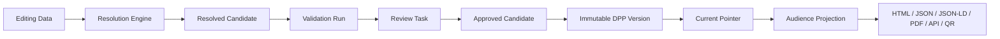

# 04 DPP Passport, Version, and Publication Model

## Core separation

### DPP Passport

`dpp_passport` is stable identity and subject binding.

```text
- id
- tenant_id
- subject_type: MODEL / SKU / BATCH / ITEM
- subject_id
- passport_profile_code: PRIMARY / EU_BATTERY / ESPR / CUSTOM / future controlled values
- passport_identifier
- schema_definition_id
- status
- created_at / created_by
```

`passport_profile_code` defaults to `PRIMARY`. At most one active Passport exists for the same Tenant, subject type, subject ID, and Passport Profile. The architecture does not assume that a subject can have only one Passport across all regulatory or market profiles.

### DPP Version

`dpp_version` is an immutable publication artifact.

```text
- id
- tenant_id
- passport_id
- version_number
- schema_version_id
- canonical_payload
- payload_hash
- content_workflow_state
- publication_state
- created_by / created_at
- published_at nullable
- supersedes_version_id nullable
```

Published content, schema binding, and hash cannot be updated or deleted. Correction creates a new version.

### Current pointer

`dpp_current_pointer` maps one Passport to zero or one current `PUBLISHED` version. Pointer changes are transactional and audited; history is never deleted.

## Publication pipeline



The publish transaction freezes resolved values, source schema version, publication metadata, canonicalization algorithm, and content hash.

## State dimensions

| Dimension | States |
|---|---|
| Content workflow | `DRAFT`, `DATA_PENDING`, `VALIDATION_FAILED`, `READY_FOR_REVIEW`, `CHANGES_REQUESTED`, `APPROVED`, `REJECTED` |
| Publication | `UNPUBLISHED`, `PUBLISHED`, `SUPERSEDED`, `WITHDRAWN` |
| Registry | `NOT_REQUIRED`, `NOT_SUBMITTED`, `PREPARING`, `VALIDATING`, `READY`, `SUBMITTED`, `ACCEPTED`, `REJECTED`, `FAILED` |
| Physical lifecycle | sector-specific, e.g. `ORIGINAL`, `REUSED`, `REPURPOSED`, `REMANUFACTURED`, `WASTE`, `EXPORTED` |

Transitions in one dimension do not silently change another. Registry rejection does not delete a locally published DPP; lifecycle events do not mutate historical DPP versions.

## Single source of truth

After V2 cutover for a Passport:

```text
Resolver → Current Pointer → immutable DPP Version → audience projection
```

Every output format derives from the same payload/version ID and exposes consistent `passportId`, `version`, `schemaVersion`, `payloadHash`, and `publishedAt` metadata.

The current repository's legacy snapshot/live-table fallback remains compatibility-only during shadow comparison. It is not permitted as a silent fallback for a Passport marked V2-primary.

## Review and duties

- author, reviewer, and publisher capabilities are distinct;
- review is bound to candidate hash and schema version;
- any source change invalidates approval unless rules explicitly classify it non-material;
- publish is idempotent for the same approved candidate;
- withdraw changes pointer/publication state, not payload history;
- supersede points both backward (`supersedes`) and through audit events;
- public projections remove private provenance/raw source values.

## Compatibility

| V1 | V2 treatment |
|---|---|
| `products.dpp_id` | identifier/legacy mapping to Passport |
| `product_versions` | import only eligible published snapshots; otherwise compatibility read |
| `dpp_publication` | map to Passport Version where hash/schema/subject can be proven |
| product/item publication pointers | map to one generalized Passport pointer |
| legacy status string | map separately to content, publication, Registry, and physical states |

Old IDs, slugs, aliases, GTINs, and QR URLs resolve through compatibility mappings. They are never reassigned to a different logical Passport.

## Acceptance criteria

- published payload UPDATE/DELETE is rejected at database level;
- the same Tenant/subject/profile has at most one active Passport;
- different profiles may create separate Passports for the same subject;
- only an approved candidate with a stable hash can publish;
- one Passport has at most one current pointer;
- pointer cannot reference a non-published or different-Tenant version;
- supersede/withdraw preserves history;
- every public representation returns the same version/hash;
- V2-primary resolution never silently reads live editing tables.

Related decisions: ADR-004 and ADR-007.
