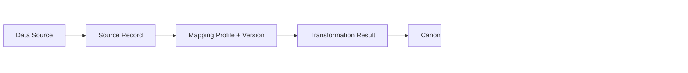

# 05 Schema, Canonical Data, and Provenance Model

## Schema authority

The only authority for new V2 fields is:

```text
Schema Definition
→ immutable Schema Version
→ Field Definition
→ Validation Rule / Applicability Rule / Access Policy
```

`dpp_field_templates`, legacy fixed columns, and the current `field_definition` implementation remain input sources through mappings. They do not evolve independently after V2 field freeze.

## Field definition contract

Each field requires:

- stable field code and semantic description;
- value type/cardinality and canonical unit;
- allowed subject levels;
- requirement/applicability rules;
- access classification and projection behavior;
- vocabulary/codelist reference where applicable;
- evidence and verification requirements;
- effective regulatory dates;
- deprecation/replacement relation;
- translation metadata without changing the semantic ID.

Published Schema Versions and their child definitions are immutable.

## Canonical ingestion model



Canonicalization begins at ingestion, not only at publication. A connector cannot write arbitrary JSON directly into a published DPP.

## Proposed objects

| Object | Responsibility |
|---|---|
| `data_source` | tenant-owned source system, provider, trust and connector reference |
| `source_record` | immutable/hash-addressed source envelope and observation metadata |
| `mapping_profile` | mapping identity for a source/schema combination |
| `mapping_version` | immutable executable mapping version |
| `mapping_rule` | source pointer → field code, transform and conditions |
| `transformation_result` | run status, errors, warnings and input/output checksums |
| `canonical_claim` | subject-scoped field value and explicit resolution state |
| `provenance_record` | who/where/when/how/evidence/verification lineage |

Raw payload retention is governed by data classification and residency. A hash/reference may replace raw content when retaining the content is unnecessary or unlawful.

## Canonical claim

Minimum semantics:

```text
tenant_id
subject_type / subject_id
field_definition_id
schema_version_id
resolution_state: INHERIT / OVERRIDE / CLEAR / NOT_APPLICABLE / UNKNOWN
value_json
canonical_unit
effective_from / effective_to
verification_status
provenance_record_id
created_at / supersedes_claim_id
```

Claims are append-oriented. Correction supersedes a claim so historical publications can still explain their inputs.

## Resolution output

For every field, the Resolution Engine returns:

```json
{
  "value": "...",
  "unit": "...",
  "resolutionState": "OVERRIDE",
  "originLevel": "BATCH",
  "originSubjectId": "...",
  "schemaVersionId": "...",
  "source": "...",
  "provenanceId": "...",
  "verification": "VERIFIED",
  "effectiveFrom": "...",
  "effectiveTo": null,
  "evidence": ["..."]
}
```

An `UNKNOWN` mandatory value and an unresolved mapping error block publication. `NOT_APPLICABLE` requires an applicability decision/reason.

## Provenance record

The provenance model must explain:

- provider Organisation and source system;
- source record and raw value/reference;
- mapping/transformation version;
- normalized value and unit conversion;
- observation, ingestion, entry, and review times;
- actor and reviewer;
- verification status/method;
- evidence file references;
- supersession chain.

Sensitive raw values and internal source identifiers remain outside public snapshots. The snapshot contains only public-safe provenance claims or evidence references.

## Legacy convergence

| Legacy | Canonical treatment | End state |
|---|---|---|
| industry fixed tables/columns | versioned mappings to Field Definitions | compatibility read until migrated |
| `dpp_field_templates` | map profile/field keys to canonical definitions | no new V2 fields added here |
| `product_sector_field_values` | transform to subject-scoped claims | legacy table read-only after cutover |
| current `field_definition` | reuse/extend where semantics align | becomes Schema authority implementation |
| `battery_field_value` | transform with Model/Batch/Item scope | battery adapter/compatibility source |

No mapping is accepted by matching display labels alone. Every mapping records source key, target field ID, rule version, lossiness, and reviewer.

## Acceptance criteria

- all new V2 fields have registered Field Definitions;
- mappings and schema versions are immutable after publication;
- unknown/unmapped values are reported, never dropped silently;
- inherited values expose origin and provenance;
- unit conversions are versioned and reproducible;
- public outputs never leak restricted raw source data;
- the same source + mapping version produces a stable canonical checksum.

Related decisions: ADR-005 and ADR-006.
