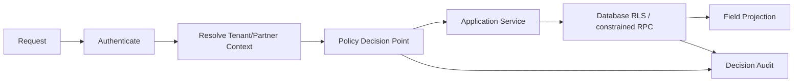

# 06 Access Control Model

## Decision

Use finite RBAC templates plus bounded attributes. Do not introduce an arbitrary policy language in Phase 1.

```text
Identity
+ Tenant context
+ Platform/Tenant/Partner relationship
+ Role-derived capabilities
+ Scope grants
+ Resource attributes
+ Field classification
+ Purpose
→ ALLOW or DENY with reason
```

Default is deny.

## Identity contexts

| Context | Source | Allowed boundary |
|---|---|---|
| Anonymous | no user | explicitly public published projections only |
| Platform user | platform role | platform capabilities; no automatic Tenant data access |
| Tenant member | active membership | one Tenant plus assigned scope |
| Partner user | Partner membership + active Tenant authorization | authorized Tenant, capability and scope only |
| Integration identity | scoped credential | named API operations/resources only |
| Impersonation session | platform approval + target Tenant + reason | short-lived, default read-only, fully audited |

## Role and capability

Role is a managed template; capability is the enforcement unit.

Initial role examples:

| Role | Example capabilities |
|---|---|
| Tenant Admin | membership manage, role assign, product scope manage |
| DPP Manager | `product.view/edit`, `dpp.create/edit/submit_review` |
| Reviewer | `dpp.view_candidate/review/approve/reject` |
| Publisher | `dpp.publish/withdraw` |
| Read Only | product and authorized DPP reads |
| Integration User | only connector/import/BMS scopes assigned |
| Partner Consultant | profile-defined capabilities limited by Partner authorization |

No application authorization should depend on repeated `if role == ...` branches. Services ask the Policy Decision Point for a capability decision.

Tenant Membership is database-bound to a same-Tenant Role with `role_class = TENANT`. A composite foreign key/discriminator prevents cross-Tenant Role references and prevents a Tenant Membership from acquiring a Platform Role. This invariant remains enforced even when application validation is bypassed.

## Scope model

A grant may restrict:

- Tenant (always required);
- Organisation;
- project;
- product Model/SKU/Batch/Item subtree;
- Passport;
- Schema/module/field classification;
- operation and purpose;
- valid time window.

Scope intersection is used for Partner users: user capability ∩ Partner–Tenant authorization ∩ requested resource.

## Field access

Initial levels remain compatible with current semantics:

```text
PUBLIC < LEGITIMATE_INTEREST < AUTHORITY_ONLY < INTERNAL
```

The requested audience limits the projection even if the user possesses a higher level. Purpose may further restrict authority-only data. Field projection occurs server-side from the immutable version.

## Policy Decision Point contract

```ts
type AccessDecision = {
  allowed: boolean;
  reasonCode: string;
  tenantId: string | null;
  capability: string;
  resource: { type: string; id: string };
  effectiveScope: Record<string, unknown>;
  fieldCeiling?: "PUBLIC" | "LEGITIMATE_INTEREST" | "AUTHORITY_ONLY" | "INTERNAL";
  policyVersion: string;
  decisionId: string;
};
```

The caller supplies a verified identity and target resource, not a preapproved role. The PDP resolves memberships and resource ownership.

## Enforcement layers



RLS is defense in depth and uses the same Tenant semantics. A service-role call must still receive an earlier PDP decision and emit an audit event.

## Impersonation design

- separate session/token, never customer password;
- reason, target Tenant, approver, capabilities, and expiry required;
- default read-only and maximum short lifetime;
- unmistakable UI banner;
- start, actions, and stop recorded;
- immediate revoke/kill switch;
- no integration credential issuance or secret viewing by default.

## Audit record

Every sensitive decision records `who`, `identity context`, `tenant`, `partner authorization`, `capability`, `scope`, `resource`, `purpose`, `allow/deny`, `reason`, `policy version`, `correlation ID`, time, and safe request metadata.

## Phase 1 negative tests

- Tenant A cannot enumerate/read/update Tenant B.
- Partner without binding is denied.
- expired/revoked/out-of-scope Partner binding is denied.
- user role without capability is denied.
- public audience cannot receive restricted fields from a privileged session.
- client-supplied Tenant header cannot override membership.
- service endpoints reject missing policy context.
- storage and RPC paths enforce the same decisions.

## Acceptance criteria

- every `/api/v2` business handler declares one or more capability requirements;
- decisions are testable without UI;
- database constraints prevent cross-Tenant relationships;
- no Platform Admin bypass is implicit;
- denied decisions have stable reason codes and audit records;
- role changes cannot mutate historical publication approvals.
