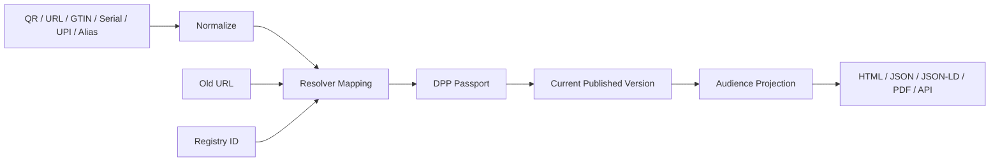

# 07 Resolver and Public Access Model

## Purpose

The Resolver translates stable external identifiers into a Passport identity and its current published version. It is independent of Registry submission and editing data.



## Resolution rules

1. Parse an approved route/scheme; reject arbitrary open redirects.
2. Normalize according to identifier scheme, without changing display value.
3. Locate one active mapping in the correct namespace/issuer.
4. Reject ambiguous, expired, revoked, cross-Tenant, or cyclic aliases.
5. Resolve Passport identity.
6. Resolve current published pointer.
7. Apply audience projection and caching policy.
8. Return stable error codes without leaking private-resource existence.

## Resolver mapping

```text
resolver_mapping
- id
- tenant_id nullable for globally routed public identifiers
- host
- path_pattern / identifier_id
- passport_id
- mapping_type: PRIMARY / ALIAS / LEGACY_REDIRECT
- valid_from / valid_until
- status
- redirect_http_status
- created_by / created_at
```

Uniqueness applies to normalized `(host, path)` for active mappings. A retired external URL cannot be silently reassigned to another Passport.

## Public URL policy

- canonical public route remains stable and opaque enough to avoid exposing internal UUIDs where possible;
- `/p/{identifier}` remains compatible during migration;
- `/01/{gtin}`, old slugs, DPP IDs, and aliases map through the same service;
- host allowlist prevents QR generation for arbitrary external hosts unless the caller explicitly uses a separate non-DPP utility;
- tenant custom domains require verified domain ownership and host-scoped mappings;
- redirect chains are bounded and cycle checked;
- cache keys include host, normalized identifier, audience and current version ID.

## QR/Data Carrier

QR is a presentation of an identifier/URL, not the identifier authority. A future `data_carrier` record may retain carrier type, encoded value, target mapping, issue time, status, and rendering profile.

Existing QR images are not replaced. Their target URLs are entered as compatibility mappings and tested continuously.

## Public access

Anonymous users receive only the `PUBLIC` projection of a `PUBLISHED` version. Restricted access uses authentication and a PDP decision; the immutable source version stays the same, while field projection changes by audience.

For withdrawn Passports, policy decides between a tombstone with reason/effective date and a non-enumerating not-found response. Historical content is never silently shown as current.

## Registry independence

Registry IDs are ordinary external identifiers. Registry acceptance, rejection, endpoint changes, or connector outages do not change canonical QR URLs or Passport identity.

## Compatibility plan

| Existing path | V2 behavior |
|---|---|
| `products.dpp_id` | identifier mapping to Passport |
| `public_slug` | legacy alias or canonical mapping |
| `dpp_identifier_alias` | imported to resolver mapping with provenance |
| code pre-migration map | materialized as reviewed mappings, then code map retired |
| GS1 `/01/{gtin}` | normalize GTIN and resolve identifier |
| named product pages | permanent route/alias to Passport |

## Observability and security

- count resolution result classes, latency, ambiguity, loops and not-found rates;
- never log full secrets or restricted payloads;
- rate-limit abusive enumeration while allowing QR scanning;
- attach correlation ID and resolved version ID;
- synthetic probes cover every legacy route class;
- alert on mapping changes for published Passports.

## Acceptance criteria

- one identifier resolves to at most one active Passport in its namespace;
- Registry changes cannot break QR resolution;
- old URLs remain functional during the compatibility window;
- HTML/JSON/JSON-LD/PDF report the same version/hash;
- V2-primary Passports cannot fall through to live V1 tables;
- alias cycles, open redirects, and cross-Tenant mappings are rejected.

Related decision: ADR-008.
