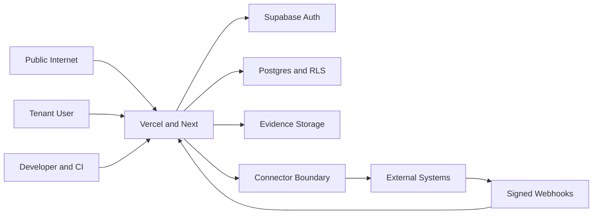

# Security review and threat model

## Executive summary

GreanLean V2 has strong intended controls for tenant authorization, immutable publications, connector SSRF/webhook protection, idempotency, and secret redaction. It is not ready for Production Pilot because those controls are not deployed or runtime-verified in Production, Next.js 14.2.15 is outside the current supported release lines and predates patched 14.2.x advisories, public responses lack common browser security headers, public Resolver capacity/rate controls are unproven, and backup/recovery is unavailable. These unaccepted high-impact risks force `SECURITY_GATE = FAIL`. Sources: [Next.js security releases](https://nextjs.org/blog) and [maintainer advisories](https://github.com/vercel/next.js/security/advisories).

## Scope and assumptions

In scope: `app/api`, `lib/server`, `lib/v2`, `supabase/migrations/0027`–`0032`, runtime configuration, public Production probes, and tests. Out of scope: Production penetration testing, paid infrastructure changes, Production secret rotation, customer connector activation, and Production data mutation.

Assumptions used because the requested context questions received no answer:

- The Pilot is invited-only and support staff can identify every Pilot tenant.
- The service is internet-facing; public DPP/Resolver endpoints are anonymous and tenant APIs require Supabase bearer tokens.
- Tenant product, provenance, evidence, audit, and connector credential references are high-sensitivity business data; no consumer special-category PII is intentionally stored.
- Production is a single-region hosted Next.js + Supabase deployment; Vercel and Supabase are trusted infrastructure providers.
- Production must preserve V1 behavior until an explicitly authorized cutover.

Open questions that materially change risk: whether public self-signup is intentional; which regulated/personal data classes exist; Pilot concurrency and availability commitments; named Security/Database/Operations owners; and accepted data residency/retention policy.

## System model

### Primary components

- Next.js application and API routes render public DPPs and serve authenticated tenant workflows (`app`, `app/api/v2`).
- Supabase Auth validates bearer tokens; server repositories use a service-role client after PDP checks (`lib/server/supabase.ts`, `lib/server/v2/security.ts`).
- PostgreSQL stores tenant/product/schema/publication/integration state with intended RLS and immutable triggers (`supabase/migrations/0027_*` through `0031_*`).
- Storage holds evidence files with signed access paths; external connectors call allowlisted endpoints and accept signed webhooks (`lib/server/dppFiles.ts`, `lib/server/v2/connectorSecurity.ts`).
- Vercel/Next logs emit correlation IDs and redact sensitive-key fields (`lib/server/apiRoute.ts`, `lib/server/logger.ts`).

### Data flows and trust boundaries

- Internet → public Resolver/DPP: identifiers and requested formats cross HTTPS; anonymous public projection and immutable current-version lookup apply; public rate limiting is not demonstrated.
- Browser/operator → tenant API: bearer token, tenant header, payload, and idempotency key cross HTTPS; Auth verifies the token and PDP resolves tenant capability/resource scope.
- Next server → Supabase: privileged service-role requests cross provider HTTPS after server-side policy checks; this boundary depends on the key remaining server-only and PDP calls never being bypassed.
- Tenant/evidence client → Storage: file metadata/content cross signed or authenticated paths; authorization and short-lived signed URLs are intended, while Production runtime verification is incomplete.
- External system → webhook: raw JSON, timestamp, and HMAC cross HTTPS; replay window and constant-time signature comparison apply.
- Connector worker → external host: mapped payloads and credentials cross HTTPS; host allowlists, DNS/IP checks, redirect revalidation, timeouts, content-type and response-size bounds apply.
- Developer/CI → deployment: source, lockfile, migrations, and environment variables become build artifacts; repository hygiene tests apply, while release provenance/deployed SHA is unverified.

#### Diagram

## Assets and security objectives

| Asset | Why it matters | Security objective (C/I/A) |
|---|---|---|
| Tenant membership and scope grants | Boundary between customers and partners | C/I/A |
| Service-role and connector credentials | Compromise bypasses normal application controls | C/I |
| Canonical claims and provenance | Basis for regulatory/public statements | I/A |
| Immutable DPP versions and resolver pointers | Public identity and publication integrity | I/A |
| Evidence files and signed URLs | May contain confidential business documents | C/I/A |
| Audit records and receipts | Incident and compliance evidence | I/A |
| Backups and recovery capability | Only path to recover destructive failure | C/I/A |
| Build artifact and deployed revision | Supply-chain and rollback identity | I/A |

## Attacker model

### Capabilities

- Anonymous remote requests to public domains, identifiers, Resolver formats, and `/api/qr`.
- Valid low-privilege or compromised tenant/partner account attempting IDOR, forged tenant headers, scope escape, or high-volume access.
- External connector/webhook operator controlling URLs, DNS, redirects, response bodies, timing, and webhook payloads.
- Malicious file/import data and replayed requests within reachable API boundaries.

### Non-capabilities

- No assumed access to Vercel/Supabase dashboards, service-role secrets, deployment credentials, or the developer workstation.
- No assumed ability to modify signed repository migrations or Production DNS without a separate supply-chain compromise.
- Production database superuser compromise and provider-internal attacks are out of scope, though recovery must tolerate operator error.

## Entry points and attack surfaces

| Surface | How reached | Trust boundary | Notes | Evidence |
|---|---|---|---|---|
| Public Resolver | Anonymous HTTPS | Internet → Next → DB | Identifier enumeration, format generation, availability | `app/api/v2/resolver/[identifier]/route.ts` |
| Legacy/public DPP and GTIN routes | Anonymous HTTPS | Internet → Next | Compatibility and redirect integrity | `app/p/[slug]/page.tsx`, `app/01/[gtin]/[[...segments]]/route.ts` |
| Arbitrary QR generator | Anonymous query parameter | Internet → QR image | Accepts an arbitrary URL; phishing/brand misuse | `app/api/qr/route.ts` |
| Tenant V2 APIs | Bearer token and tenant header | User → Auth/PDP/service role | Highest IDOR/cross-tenant risk | `lib/server/v2/security.ts`, `lib/server/v2/policyDecisionPoint.ts` |
| Evidence access | Authenticated upload/signed download | User → Storage | Confidential files and URL replay | `app/api/internal/dpp-files`, `app/api/dpp-files/[versionId]/route.ts` |
| External connector | Authenticated configuration/job | Tenant → server → external host | SSRF, secrets, oversized/malicious responses | `lib/server/v2/genericRestConnector.ts` |
| Webhook | Anonymous signed POST | External system → server | Forgery, replay, burst | `app/api/v2/webhooks/[connectorCode]/route.ts` |
| Publication workflow | Authenticated writes | Tenant roles → immutable DB | False publication or pointer mutation | `lib/server/v2/phase4Repository.ts`, migration `0030_*` |
| Deployment configuration | Build/deploy environment | Developer/CI → runtime | Secret leakage and revision mismatch | `next.config.mjs`, `.env.example` |

## Top abuse paths

1. Cross-tenant actor supplies another tenant/resource identifier → finds a missing PDP/RLS check → reads or mutates another customer's product/evidence data.
2. Attacker finds a route using the service-role client before policy resolution → bypasses RLS → performs privileged database operations.
3. Connector administrator supplies an allowlisted hostname with malicious DNS/redirect behavior → reaches private metadata or internal services → steals credentials/data.
4. Adversary replays or forges webhook events → changes connector/Registry state → causes incorrect external status or job execution.
5. Attacker enumerates public identifiers and floods expensive JSON/PDF/QR generation → exhausts server/database capacity → public DPP outage.
6. Compromised reviewer/publisher account approves a malicious candidate → publishes a false immutable DPP → regulatory and customer harm.
7. Operator deploys a vulnerable/outdated framework artifact without revision provenance → exploitable web-layer flaw or uncertain rollback target.
8. Destructive database event occurs without a verified backup/restore path → irreversible loss and prolonged outage.
9. Public arbitrary QR URL is used with GreanLean branding → victim scans a malicious destination → phishing/reputation harm.

## Threat model table

| Threat ID | Threat source | Prerequisites | Threat action | Impact | Impacted assets | Existing controls (evidence) | Gaps | Recommended mitigations | Detection ideas | Likelihood | Impact severity | Priority |
|---|---|---|---|---|---|---|---|---|---|---|---|---|
| TM-001 | Internet attacker | Exploitable issue in unsupported Next 14.2.15/runtime chain | Exploit framework vulnerability | Server compromise or data exposure | Credentials, tenant data, publication state | Lockfile/hygiene checks; build passes | Current supported Next release not used; advisory closure not demonstrated | Plan a tested upgrade to supported 15.5.x or 16.x; run dependency/advisory review before Pilot | WAF/runtime anomaly and dependency alerts | Medium | High | high |
| TM-002 | Web attacker | Browser renders affected pages | XSS framing/content-sniffing chain has fewer browser defenses | Session/user harm, clickjacking | User actions, brand | React escaping; HSTS | No CSP, nosniff, or frame protection on probes; `next.config.mjs` has no headers | Add and test CSP, `nosniff`, frame-ancestors, Referrer-Policy, Permissions-Policy | CSP reports and edge header monitor | Medium | High | high |
| TM-003 | Malicious tenant/partner | Valid account or guessed object ID | Forge tenant/resource scope and exploit IDOR | Cross-tenant disclosure/mutation | Tenant data, evidence | Auth user lookup; shared PDP; database RLS contracts (`security.ts`, `policyDecisionPoint.ts`) | Production V2 absent; no Production/PreProd negative runtime test | Run cross-tenant/forged-header matrix in PreProd; verify deployed RLS catalog | PDP deny anomalies and cross-tenant audit queries | Medium | High | high |
| TM-004 | Route implementation defect | Service-role client used before complete authorization | Bypass RLS through application server | Broad privileged access | All database assets | Server-only constructor; policy contexts; `.env` untracked (`supabase.ts`) | Route-by-route runtime proof and service-role blast-radius review incomplete | Enforce repository APIs requiring verified context; add static rule and integration negatives | Alert on service-role writes lacking PDP audit correlation | Low/Medium | High | high |
| TM-005 | External connector operator | Can configure connector or control DNS/redirect | SSRF or oversized/malicious response | Internal network access, secret exposure, DoS | Credentials, availability | HTTPS allowlist, DNS/IP/private checks, redirect revalidation, limits (`connectorSecurity.ts`, `genericRestConnector.ts`) | DNS rebinding/TOCTOU and PreProd runtime matrix incomplete | Pin resolved public IP per request or use controlled egress proxy; test rebinding/IPv6/redirects | Egress destination and rejected-host metrics | Medium | High | high |
| TM-006 | Webhook sender | Knows endpoint; may capture signed request | Forge/replay/burst callback | Incorrect Registry/job state or DoS | Receipts, connector state | Timestamped HMAC and timing-safe compare (`connectorSecurity.ts`) | Global burst control and secret rotation drill unproven | Add edge rate limits, per-connector quotas, replay-store tests, dual-key rotation procedure | Invalid signature/replay/burst alerts | Medium | Medium/High | high |
| TM-007 | Anonymous bot | Public identifier or brute force | Enumerate and flood Resolver/PDF/QR | Availability loss, unintended metadata discovery | Public service, identifiers | Public projection; immutable pointer; cache headers (`resolver route`) | No proven public rate limit/capacity; PDF cost unmeasured | Edge cache, per-route rate limit, bounded format generation, load-tested SLO | Resolver error/latency/enumeration alerts | High | Medium | high |
| TM-008 | Compromised reviewer/publisher | Privileged tenant account | Publish false or malicious claims | Regulatory/reputation harm | Publications, provenance | Role capabilities, review/approval stages, immutable versions/audit (`phase4Repository.ts`, `0030_*`) | MFA/session policy and Production runtime evidence not verified | Require MFA for privileged roles, separation of duties, approval alerts, break-glass process | Publish/withdraw anomaly and unusual reviewer alerts | Medium | High | high |
| TM-009 | Operator error/provider incident | Destructive data event | Data becomes unavailable with no restorable copy | Irrecoverable loss/outage | All persistent assets | None demonstrated for current plan | No verified backup, PITR, storage backup, or restore drill | Enable paid backup/PITR, export strategy, isolated timed restore, accepted RPO/RTO | Backup freshness and restore-test alerts | Medium | High | critical |
| TM-010 | Anonymous user | Access to `/api/qr` | Generate QR for attacker-controlled URL under service origin | Phishing and brand abuse | Users, brand | Image-only response | No host allowlist in legacy QR route | Restrict to approved Resolver origins or deprecate behind compatibility plan | Log rejected hosts and unusual QR volume | Medium | Medium | medium |

## Criticality calibration

- **Critical:** plausible loss of all tenant/publication data with no recovery; remote compromise of service-role credentials; undetected cross-tenant bulk write. Examples: TM-009, a proven service-role leak, or mutable published-version takeover.
- **High:** cross-tenant read/write, false regulatory publication, exploitable supported-path web flaw, or sustained public outage. Examples: TM-001, TM-003, TM-008.
- **Medium:** bounded phishing/brand abuse, single-tenant disruption, or defense-in-depth gaps requiring another exploit. Examples: TM-010, isolated header weakness without an injection primitive, bounded webhook replay.
- **Low:** developer-only/test-only issue with no deployed path, low-impact metadata exposure, or a strongly constrained abuse requiring trusted administrator access.

## Focus paths for security review

| Path | Why it matters | Related Threat IDs |
|---|---|---|
| `lib/server/v2/security.ts` | Central authentication, feature, and policy boundary | TM-003, TM-004 |
| `lib/server/v2/policyDecisionPoint.ts` | Tenant/partner/resource authorization and deny audit | TM-003, TM-004 |
| `lib/server/supabase.ts` | Creates bearer-scoped and service-role clients | TM-004 |
| `app/api/v2` | Full V2 route attack surface | TM-003–TM-008 |
| `lib/server/v2/phase4Repository.ts` | Publication, review, resolver, and audit mutations | TM-008 |
| `lib/server/v2/phase5Repository.ts` | Connector, Registry, webhook, BMS, and receipts | TM-005, TM-006 |
| `lib/v2/connectorSecurity.ts` | SSRF, HMAC, redaction, and response bounds | TM-005, TM-006 |
| `app/api/v2/resolver/[identifier]/route.ts` | Anonymous public formats and DB lookup | TM-007 |
| `app/api/qr/route.ts` | Arbitrary URL QR generation | TM-010 |
| `lib/server/logger.ts` | Secret redaction and audit safety | TM-004, TM-006 |
| `supabase/migrations/0027_v2_phase1_tenant_access_foundation.sql` | Core RLS/PDP data model | TM-003 |
| `supabase/migrations/0030_v2_phase4_passport_publication_resolver.sql` | Immutability and Resolver integrity | TM-007, TM-008 |
| `supabase/migrations/0031_v2_phase5_integration_registry_connectors.sql` | Connector privileges, secrets, limits, append-only evidence | TM-005, TM-006 |
| `next.config.mjs` | Missing browser security header policy | TM-002 |
| `package.json` and lockfile | Framework/dependency support status | TM-001 |

Quality check: public/authenticated/external/build entry points are covered; every trust boundary appears in the threats; runtime is separated from Development/tests; unanswered context is recorded as assumptions; secrets are not reproduced.
